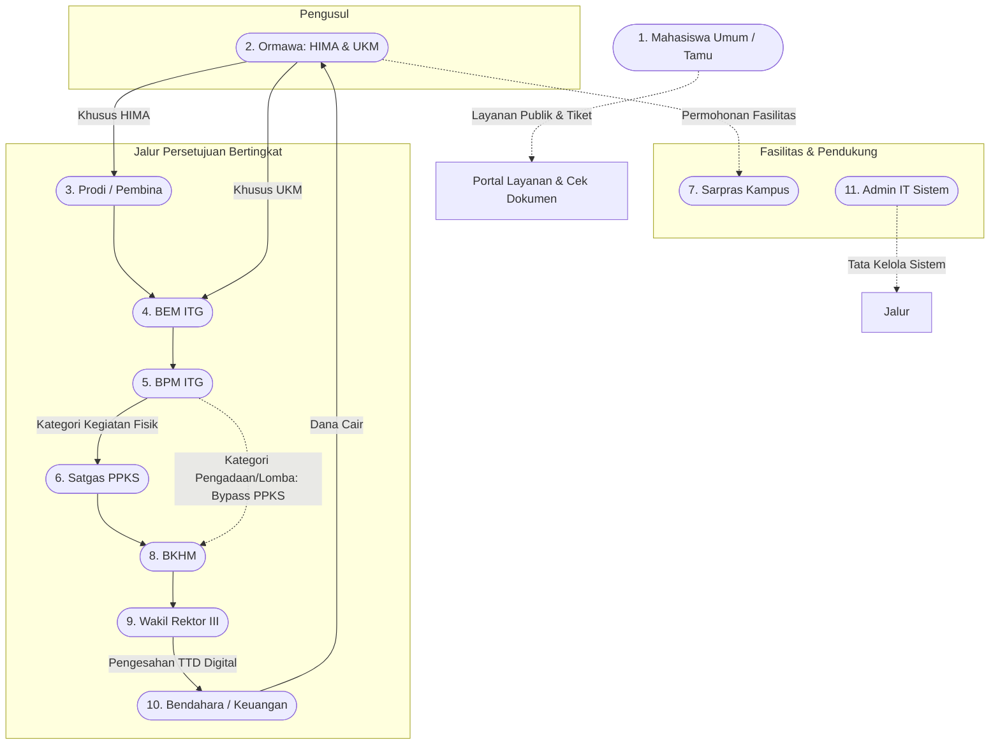

# NASKAH PANDUAN LENGKAP: ALUR PENGGUNAAN FITUR & PENJELASAN DASHBOARD (SKIN ITG)
**Sistem Informasi Kemahasiswaan Terpadu — Institut Teknologi Garut**  
*Panduan Operasional Komprehensif: Dari Mahasiswa Umum, Ormawa, Pengawas Parlemen, Satgas PPKS, hingga Wakil Rektor III*

---

## DAFTAR ISI NASKAH PANDUAN
1. [Struktur Ekosistem & Peta Peran Pengguna (11 Aktor)](#1-struktur-ekosistem--peta-peran-pengguna)
2. [Aktor 1: Mahasiswa Umum (Portal Publik & Guest Services)](#2-aktor-1-mahasiswa-umum-portal-publik--guest-services)
   - [2.1 Tampilan & Komponen Dashboard Portal Mahasiswa](#21-tampilan--komponen-dashboard-portal-mahasiswa)
   - [2.2 Naskah Alur Penggunaan Fitur Layanan Mahasiswa](#22-naskah-alur-penggunaan-fitur-layanan-mahasiswa)
3. [Aktor 2: Organisasi Mahasiswa / ORMAWA (HIMA & UKM)](#3-aktor-2-organisasi-mahasiswa--ormawa-hima--ukm)
   - [3.1 Tampilan & Komponen Dashboard Ormawa](#31-tampilan--komponen-dashboard-ormawa)
   - [3.2 Naskah Alur Fitur Program Kerja & ACC Prodi](#32-naskah-alur-fitur-program-kerja--acc-prodi)
   - [3.3 Naskah Alur Generator Proposal Otomatis (3 Format)](#33-naskah-alur-generator-proposal-otomatis-3-format)
   - [3.4 Naskah Alur Pengajuan Dana Kegiatan vs Non-Kegiatan (Bypass PPKS)](#34-naskah-alur-pengajuan-dana-kegiatan-vs-non-kegiatan)
   - [3.5 Naskah Alur Generator 13 Kategori Surat Resmi](#35-naskah-alur-generator-13-kategori-surat-resmi)
   - [3.6 Naskah Alur Peminjaman Sarana & Prasarana Kampus](#36-naskah-alur-peminjaman-sarana--prasarana-kampus)
   - [3.7 Naskah Alur Pelaporan LPJ & Pengembalian Sisa Kas](#37-naskah-alur-pelaporan-lpj--pengembalian-sisa-kas)
4. [Aktor 3: Program Studi / Pembina Himpunan (PRODI)](#4-aktor-3-program-studi--pembina-himpunan-prodi)
   - [4.1 Tampilan & Komponen Dashboard Prodi](#41-tampilan--komponen-dashboard-prodi)
   - [4.2 Naskah Alur Evaluasi & ACC Program Kerja HIMA](#42-naskah-alur-evaluasi--acc-program-kerja-hima)
   - [4.3 Naskah Alur Verifikasi Tahap 1 Proposal HIMA](#43-naskah-alur-verifikasi-tahap-1-proposal-hima)
   - [4.4 Naskah Alur KPI & Rapor Capaian HIMA](#44-naskah-alur-kpi--rapor-capaian-hima)
5. [Aktor 4: Badan Eksekutif Mahasiswa (BEM)](#5-aktor-4-badan-eksekutif-mahasiswa-bem)
   - [5.1 Tampilan & Komponen Dashboard BEM](#51-tampilan--komponen-dashboard-bem)
   - [5.2 Naskah Alur Verifikasi Tahap 2 Proposal Ormawa](#52-naskah-alur-verifikasi-tahap-2-proposal-ormawa)
   - [5.3 Naskah Alur Kurasi & Publikasi Warta Ormawa](#53-naskah-alur-kurasi--publikasi-warta-ormawa)
   - [5.4 Naskah Alur Penjadwalan Rapat Koordinasi Ormawa](#54-naskah-alur-penjadwalan-rapat-koordinasi-ormawa)
6. [Aktor 5: Badan Perwakilan Mahasiswa (BPM)](#6-aktor-5-badan-perwakilan-mahasiswa-bpm)
   - [6.1 Tampilan & Komponen Dashboard BPM](#61-tampilan--komponen-dashboard-bpm)
   - [6.2 Naskah Alur Verifikasi Tahap 3 (Routing Jalur PPKS vs Bypass BKHM)](#62-naskah-alur-verifikasi-tahap-3-routing-jalur-ppks-vs-bypass-bkhm)
   - [6.3 Naskah Alur Pengelolaan & Advokasi Aspirasi Kampus](#63-naskah-alur-pengelolaan--advokasi-aspirasi-kampus)
   - [6.4 Naskah Alur Penerbitan Surat Peringatan (SP) Parlemen](#64-naskah-alur-penerbitan-surat-peringatan-sp-parlemen)
7. [Aktor 6: Satuan Tugas Pencegahan & Penanganan Kekerasan Seksual (SATGAS PPKS)](#7-aktor-6-satuan-tugas-ppks)
   - [7.1 Tampilan & Komponen Dashboard Satgas PPKS](#71-tampilan--komponen-dashboard-satgas-ppks)
   - [7.2 Naskah Alur Verifikasi Pakta Integritas Izin Kegiatan](#72-naskah-alur-verifikasi-pakta-integritas-izin-kegiatan)
   - [7.3 Naskah Alur Penerbitan Surat Peringatan (SP) Pelanggaran Etika/PPKS](#73-naskah-alur-penerbitan-surat-peringatan-sp-ppks)
8. [Aktor 7: Bagian Sarana & Prasarana (SARPRAS)](#8-aktor-7-bagian-sarana--prasarana-sarpras)
   - [8.1 Tampilan & Komponen Dashboard Sarpras](#81-tampilan--komponen-dashboard-sarpras)
   - [8.2 Naskah Alur Validasi Peminjaman Ruangan & Jadwal Kuliah Anti-Bentrok](#82-naskah-alur-validasi-peminjaman-ruangan-anti-bentrok)
   - [8.3 Naskah Alur Peminjaman Barang & Surat Izin Keluar Kampus](#83-naskah-alur-peminjaman-barang--surat-izin-keluar-kampus)
9. [Aktor 8: Biro Kemahasiswaan & Hubungan Alumni (BKHM)](#9-aktor-8-biro-kemahasiswaan--hubungan-alumni-bkhm)
   - [9.1 Tampilan & Komponen Dashboard BKHM (Pusat Kendali Operasional)](#91-tampilan--komponen-dashboard-bkhm)
   - [9.2 Naskah Alur Verifikasi Kelayakan Administratif Proposal ke WR3](#92-naskah-alur-verifikasi-kelayakan-administratif-proposal)
   - [9.3 Naskah Alur Alokasi Saldo Pagu & Rekonsiliasi Kas Ormawa](#93-naskah-alur-alokasi-saldo-pagu--rekonsiliasi-kas)
   - [9.4 Naskah Alur Verifikasi & Pengesahan LPJ Kegiatan](#94-naskah-alur-verifikasi--pengesahan-lpj-kegiatan)
10. [Aktor 9: Wakil Rektor III Bidang Kemahasiswaan (WR3)](#10-aktor-9-wakil-rektor-iii-bidang-kemahasiswaan-wr3)
    - [10.1 Tampilan & Komponen Dashboard WR3 (Executive Command Center)](#101-tampilan--komponen-dashboard-wr3)
    - [10.2 Naskah Alur Pengesahan Proposal & TTD Digital Kriptografis (SHA-256)](#102-naskah-alur-pengesahan-proposal--ttd-digital-kriptografis)
    - [10.3 Naskah Alur Validasi & Pengesahan Surat Peringatan Institusional](#103-naskah-alur-validasi--pengesahan-surat-peringatan-institusional)
11. [Aktor 10: Bagian Keuangan / Bendahara Kampus](#11-aktor-10-bagian-keuangan--bendahara-kampus)
    - [11.1 Tampilan & Komponen Dashboard Bendahara](#111-tampilan--komponen-dashboard-bendahara)
    - [11.2 Naskah Alur Pencairan Anggaran Bertahap & Upload Bukti Transfer](#112-naskah-alur-pencairan-anggaran-bertahap--upload-bukti-transfer)
12. [Aktor 11: Administrator Sistem (ADMIN IT)](#12-aktor-11-administrator-sistem-admin-it)
    - [12.1 Tampilan & Komponen Dashboard Admin](#121-tampilan--komponen-dashboard-admin)
    - [12.2 Naskah Alur Manajemen Pengguna, Konfigurasi Pejabat, & Penanganan Bug](#122-naskah-alur-manajemen-pengguna-konfigurasi-pejabat--penanganan-bug)
13. [Rangkuman Matriks Navigasi Cepat](#13-rangkuman-matriks-navigasi-cepat)

---

## 1. STRUKTUR EKOSISTEM & PETA PERAN PENGGUNA

Sistem Informasi Kemahasiswaan Terpadu (**SKIN ITG**) mengadopsi prinsip **Role-Based Access Control (RBAC)** ketat yang membagi tata kelola kemahasiswaan ke dalam 11 aktor dengan hak akses spesifik dan rantai audit (*audit trail*) otomatis.

---

## 2. AKTOR 1: MAHASISWA UMUM (PORTAL PUBLIK & GUEST SERVICES)

Mahasiswa Umum dapat mengakses layanan kampus terpadu secara langsung **tanpa perlu login (Guest Model)** melalui antarmuka portal publik yang responsif dan ramah pengguna.

### 2.1 Tampilan & Komponen Dashboard Portal Mahasiswa (`/` atau `/layanan`)

Ketika mahasiswa membuka portal utama SKIN ITG, dashboard publik menyajikan:
1. **Banner Sambutan & Pencarian Cepat Layanan:** Kolom pencarian interaktif untuk menemukan layanan advokasi, regulasi, dan informasi warta secara instan.
2. **Kartu Pintas 4 Layanan Utama (Interactive Cards):**
   - 📢 **Suara Mahasiswa (Aspirasi):** Akses langsung pengaduan sarana prasarana, fasilitas lab, kurikulum, dan kehidupan kampus.
   - 🛡️ **Layanan Konseling & Advokasi PPKS:** Ruang aman pelaporan kekerasan seksual, perundungan, atau bantuan kesehatan mental mahasiswa.
   - 🏆 **Pelaporan Prestasi Mahasiswa:** Formulir mandiri pencatatan kejuaraan lomba regional/nasional/internasional.
   - 🔍 **Lacak Status Tiket Layanan:** Kotak pencarian status penanganan laporan berbasis nomor tiket unik.
3. **Widget Etalase Prestasi Kampus (Showcase):** Galeri bergulir yang menampilkan nama mahasiswa berprestasi ITG, raihan medali/juara, program studi, dan dokumentasi kejuaraan yang telah lolos kurasi.
4. **Pusat Informasi & Warta Ormawa Terkini:** Feed berita kegiatan himpunan/UKM yang sudah dikurasi oleh BEM.
5. **Widget Verifikasi Dokumen Digital (QR Code Scanner):** Fitur untuk memastikan keaslian surat izin kegiatan, surat dispensasi, atau SK pimpinan kampus.

---

### 2.2 Naskah Alur Penggunaan Fitur Layanan Mahasiswa

#### Skenario 1: Menyampaikan Aspirasi / Pengaduan Kampus
1. Mahasiswa mengklik menu **"Kirim Aspirasi"** pada portal publik (`/aspirasi`).
2. Mengisi formulir:
   - **Nama & NIM:** Bersifat opsional jika memilih opsi anonim.
   - **Opsi Rahasia (Centang "Kirim Sebagai Anonim"):** Identitas mahasiswa disamarkan sepenuhnya oleh enkripsi database untuk melindungi pelapor.
   - **Kategori Aspirasi:** Memilih topik (Akademik, Fasilitas/Sarpras, Keuangan, Kebijakan Ormawa, Dosen/Staf).
   - **Judul & Uraian Lengkap:** Menjelaskan kendala secara spesifik.
   - **Unggah Bukti Pendukung:** Lampiran foto atau dokumen format JPG/PNG/PDF (maksimal 5MB).
3. Mengklik tombol **"Kirim Aspirasi Sekarang"**.
4. **Sistem Menghasilkan Nomor Tiket Unik** (contoh: `TK-ASP-202611-0089`). Simpan nomor ini untuk pengecekan berkala.
5. Aspirasi otomatis masuk ke dashboard **BPM (Parlemen Mahasiswa)** untuk ditindaklanjuti.

#### Skenario 2: Melaporkan Prestasi Mahasiswa Mandiri
1. Mahasiswa mengklik tombol **"Lapor Prestasi"** (`/prestasi`).
2. Mengisi data kejuaraan:
   - Nama lengkap mahasiswa & anggota tim (jika delegasi beregu).
   - Program Studi & Angkatan.
   - Nama kompetisi / lomba, penyelenggara, dan tautan info lomba resmi.
   - Tingkat kompetisi: Kabupaten/Kota, Provinsi, Nasional (Puspresnas/DIKTI), atau Internasional.
   - Capaian juara (Juara 1, 2, 3, Harapan, Best Presentation).
   - Unggah berkas wajib: **Scan Sertifikat/Piagam Asli** dan **Foto Dokumentasi Penyerahan Trophy/Panggung**.
3. Klik **"Kirim Laporan Prestasi"**. Mahasiswa mendapatkan tiket `TK-PRS-...`.
4. Berkas akan diverifikasi oleh **BEM / BKHM** untuk diinput ke database SIMKATMAWA ITG dan dipajang di Showcase Prestasi Kampus.

#### Skenario 3: Memeriksa Status Tiket Layanan (Tracking)
1. Buka menu **"Cek Status Tiket"** (`/tracking` atau `/cek-status`).
2. Masukkan nomor tiket layanan pada kolom yang tersedia (misal: `TK-ASP-202611-0089`).
3. Klik **"Lacak Progres"**.
4. Sistem menampilkan linimasa status:
   - `Pending` (Laporan Diterima Sistem)
   - `Diproses` (Sedang dalam investigasi / koordinasi BPM & Bagian Terkait)
   - `Selesai` (Telah ditindaklanjuti, dilengkapi pesan tanggapan resmi dari parlemen).

#### Skenario 4: Verifikasi Keabsahan Dokumen Digital (Anti-Pemalsuan)
1. Mahasiswa, dosen, atau pihak luar membuka halaman **"Verifikasi Dokumen"** (`/verifikasi-dokumen`) atau langsung memindai QR Code pada lembar surat/SK menggunakan kamera ponsel.
2. Sistem mengecek *cryptographic hash token* pada URL.
3. Halaman verifikasi publik menampilkan lembar keabsahan resmi:
   - **Status Dokumen:** `TERVERIFIKASI & SAH SECARA HUKUM` (Badge Hijau Centang).
   - **Nomor Surat & Tanggal Terbit:** Tertera lengkap.
   - **Pejabat Penandatangan:** Nama Pejabat (misal: Wakil Rektor III / Ketua Ormawa), NIDN/NIM resmi, dan jabatan.
   - **Stempel Waktu Digital (ISO Timestamp):** Waktu detik penandatanganan dilakukan.
   - **Ringkasan Hash SHA-256 Dokumen.**

---

## 3. AKTOR 2: ORGANISASI MAHASISWA / ORMAWA (HIMA & UKM)

Ormawa adalah motor penggerak kegiatan mahasiswa di ITG. Akun Ormawa dibagi menjadi dua entitas: **HIMA (Himpunan Mahasiswa Jurusan)** yang terikat pada prodi, dan **UKM (Unit Kegiatan Mahasiswa)** di tingkat institut.

### 3.1 Tampilan & Komponen Dashboard Ormawa (`/dashboard`)

Dashboard Ormawa dirancang dengan tema *Modern Academic Executive* yang informatif:
1. **5 Kartu Finansial & Operasional Utama:**
   - 🟢 **Sisa Saldo Kas Ormawa (Rp):** Saldo kas riil ormawa yang tersedia dan siap diajukan untuk kegiatan berikutnya.
   - 🔵 **Total Pagu Anggaran (Rp):** Plafon pagu alokasi dana yang diberikan institut pada periode anggaran berjalan.
   - 🟡 **Dana Terpakai & Diproses (Rp):** Total dana yang telah disetujui WR3 dan sedang dalam proses pencairan di bendahara.
   - 🟣 **Total Usulan Proposal:** Akumulasi seluruh pengajuan yang pernah dibuat kepengurusan ormawa.
   - 🔴 **Proposal Review Aktif:** Jumlah pengajuan yang saat ini sedang menunggu telaah verifikator.
2. **Visual Progress Bar Penyerapan Pagu:** Menampilkan persentase perbandingan antara sisa saldo vs anggaran yang telah terealisasi.
3. **Banner Peringatan Tindakan Wajib (Actionable Alerts):**
   - ⚠️ **Peringatan Tunggakan LPJ:** Kotak kuning/merah jika terdapat kegiatan yang dananya sudah dicairkan oleh Bendahara namun belum diunggah LPJ-nya. Dilengkapi tombol langsung `Unggah LPJ Sekarang`.
   - 🚨 **Pemberitahuan Surat Peringatan (SP) Aktif:** Kotak merah jika ormawa memiliki SP dari BPM atau Satgas PPKS dengan tombol `Lihat Dokumen Sanksi`.
4. **Widget Kalender Fasilitas & Peminjaman Ruangan Mendatang:** Daftar ruangan gedung kampus yang telah disetujui peminjamannya untuk persiapan kegiatan ormawa.
5. **Widget Jadwal Rapat Kampus Terdekat:** Kalender koordinasi pimpinan ormawa dengan tautan video conference (Zoom/GMeet).
6. **Tombol Pintas Aksi Cepat (Quick Actions Grid):** Akses instan 1-klik untuk `Buat Pengajuan Baru`, `Proposal Otomatis`, `Generator Surat Digital`, `Pinjam Sarpras`, dan `Kelola Proker`.

---

### 3.2 Naskah Alur Fitur Program Kerja & ACC Prodi

Setiap awal kepengurusan, Ormawa mendaftarkan cetak biru program kerja (Proker) tahunannya:
1. Masuk ke menu navigasi **"Program Kerja"** (`/proker`).
2. Klik tombol **"+ Tambah Proker Baru"**.
3. Mengisi informasi proker:
   - **Nama Program Kerja:** (misal: *Workshop Nasional Artificial Intelligence 2026*).
   - **Deskripsi & Tujuan:** Luaran yang ditargetkan bagi mahasiswa.
   - **Rencana Pelaksanaan:** Estimasi rentang tanggal kegiatan.
4. Klik **"Simpan Program Kerja"**.
5. **Khusus Akun HIMA:**
   - Proker otomatis diberi status `⏳ Menunggu ACC Prodi`.
   - Sistem mengirimkan notifikasi in-app kepada Dosen Pembina / Ketua Program Studi jurusan terkait.
   - HIMA memantau kolom **Status ACC Prodi** pada tabel proker.
   - Apabila Prodi menyetujui, badge berubah menjadi `✓ Di-ACC Prodi`. Proker kini telah valid dan berhak diajukan proposal anggarannya.
   - Jika Prodi meminta revisi (misal karena bentrok dengan jadwal Ujian Akhir Semester), HIMA mengklik tombol edit untuk menyesuaikan tanggal lalu mengajukan ulang.

---

### 3.3 Naskah Alur Generator Proposal Otomatis (3 Format)

Ormawa tidak perlu lagi menyusun proposal secara manual di Microsoft Word. Sistem menyediakan mesin pembuat proposal otomatis berstandar ITG:
1. Buka menu **"Generator Proposal"** (`/generator/proposal`).
2. Klik **"Buat Proposal Otomatis Baru"**.
3. **Pilih Template Spesifik Sesuai Kebutuhan:**
   - 🎪 **Template Kegiatan Mahasiswa:** Memuat form latar belakang, tujuan, susunan kepanitiaan, target peserta, dan indikator luaran.
   - 📦 **Template Pengadaan Barang:** Memuat form urgensi inventaris ormawa, spesifikasi unit alat, masa pakai barang, dan penanggung jawab aset.
   - 🏆 **Template Pendanaan Lomba:** Memuat nama delegasi kontingen mahasiswa, dosen pendamping, profil lomba DIKTI/SIMKATMAWA, serta pos biaya akomodasi & registrasi.
4. **Mengisi Rencana Anggaran Biaya (RAB Dinamis):**
   - Klik **"+ Tambah Item Pos Belanja"**.
   - Masukkan uraian, volume, satuan, dan harga satuan (contoh: *Sewa Sound System - 2 Hari - Rp 500.000*).
   - Subtotal dan total RAB dihitung otomatis oleh sistem dan divalidasi agar tidak melampaui sisa saldo pagu ormawa.
5. Klik **"Simpan & Pratinjau Dokumen"**.
6. Sistem menyusun naskah rapi ber-KOP resmi ormawa, struktur tabel RAB, dan kolom tanda tangan.
7. Tersedia tombol **"🚀 Ajukan Dana Resmi"** yang otomatis memindahkan seluruh data kegiatan dan nominal dana ke form pengajuan proposal kampus tanpa perlu mengetik ulang!

---

### 3.4 Naskah Alur Pengajuan Dana Kegiatan vs Non-Kegiatan

#### A. Alur Pengajuan Kategori Kegiatan (Melibatkan Kerumunan Mahasiswa)
1. Buka menu **"Pengajuan" > "Buat Pengajuan Baru"** (`/pengajuan/create`).
2. Pilih Kategori: **Kegiatan Mahasiswa**.
3. Pilih Program Kerja terkait (hanya proker yang sudah berstatus `Di-ACC Prodi` yang dapat dipilih).
4. Masukkan nama kegiatan, tanggal mulai, tanggal selesai, lokasi pelaksanaan, dan nominal dana diajukan.
5. **Unggah Dokumen Wajib:**
   - Berkas Proposal Lengkap & RAB (PDF).
   - **Dokumen Izin / Pakta Integritas Satgas PPKS (PDF):** Lembar komitmen kepatuhan anti-kekerasan seksual, mitigasi risiko kegiatan, dan kontak narahubung darurat panitia.
6. Klik **"Kirim Pengajuan Proposal"**.
7. Status proposal: `PRODI_REVIEW` (jika HIMA) atau `SUBMITTED` (jika UKM). Proposal akan menempuh alur lengkap: **Prodi -> BEM -> BPM -> Satgas PPKS -> BKHM -> WR3 -> Bendahara**.

#### B. Alur Pengajuan Kategori Non-Kegiatan (Pengadaan Barang & Pendanaan Lomba - Bypass PPKS)
1. Buka menu **"Pengajuan" > "Buat Pengajuan Baru"**.
2. Pilih Kategori: **Pengadaan Barang & Inventaris** ATAU **Pendanaan Lomba / Delegasi Kompetisi**.
3. Masukkan judul pengajuan dan nominal anggaran dari tabel RAB.
4. **Keuntungan Jalur Khusus (Bypass PPKS):**
   - Form dokumen instrumen Satgas PPKS otomatis dihilangkan oleh sistem (tidak wajib upload pakta integritas karena bukan kerumunan fisik).
5. Klik **"Kirim Pengajuan"**.
6. Ketika proposal disetujui BEM dan sampai di meja **BPM**, tombol aksi BPM berubah menjadi **"Setujui (Langsung ke BKHM)"**.
7. Proposal **melewati (bypass) Satgas PPKS** dan langsung masuk ke meja verifikasi administrasi **BKHM**, memangkas waktu birokrasi hingga 50%!

---

### 3.5 Naskah Alur Generator 13 Kategori Surat Resmi

Ormawa dapat menerbitkan surat dinas resmi dengan nomor surat otomatis, KOP terstandarisasi, dan multi-tanda tangan digital:
1. Buka menu **"Generator Surat"** (`/generator/letters`).
2. Klik **"+ Buat Surat Baru"**.
3. Pilih dari 13 Kategori Surat Resmi ITG:
   - Surat Permohonan Dispensasi Kuliah
   - Surat Peminjaman Ruangan / Tempat
   - Surat Peminjaman Barang / Alat Sarpras
   - Surat Undangan Pembicara / Dosen / Pemateri
   - Surat Permohonan Delegasi Lomba
   - Surat Keterangan Aktif Kepengurusan
   - Surat Rekomendasi Kegiatan
   - Surat Pengantar Proposal
   - Surat Permohonan Kerjasama / Sponsor
   - Surat Pemberitahuan Kegiatan
   - Surat Mandat / Tugas Delegasi
   - Surat Keputusan (SK) Internal Ormawa
   - Surat Peringatan Internal Organisasi
4. Mengisi formulir dinamis sesuai kategori (contoh dispensasi: input nama dosen, mata kuliah, daftar NIM mahasiswa yang meminta izin).
5. Memilih struktur penandatangan (Ketua Umum, Sekretaris Umum, dan Dosen Pembina).
6. Klik **"Terbitkan Surat"**. Surat siap diunduh berformat PDF resmi ber-QR Code atau dicetak langsung.

---

### 3.6 Naskah Alur Peminjaman Sarana & Prasarana Kampus

1. Buka menu **"Sarpras" > "Peminjaman Tempat"** atau **"Peminjaman Barang"**.
2. **Peminjaman Tempat:**
   - Memilih ruangan (misal: *Aula Rektorat Lt. 3*, *Lab Komputer Jaringan*, *Ruang Kelas C-201*).
   - Memilih tanggal dan jam pemakaian.
   - Sistem secara cerdas melakukan **Deteksi Bentrok Otomatis** dengan jadwal perkuliahan semester dan peminjaman ormawa lain. Jika bentrok, sistem memberi notifikasi jadwal yang bertabrakan.
   - Mengisi agenda kegiatan dan mengunggah surat permohonan.
3. **Peminjaman Barang:**
   - Memilih barang inventaris (misal: *Proyektor Epson, Kabel Roll, Mic Wireless*).
   - Memasukkan kuantitas unit dan tanggal pengembalian.
4. Klik **"Ajukan Peminjaman"**.
5. Permohonan masuk ke antrean **Sarpras** dan **BKHM** untuk verifikasi ketersediaan fasilitas fisik.

---

### 3.7 Naskah Alur Pelaporan LPJ & Pengembalian Sisa Kas

1. Setelah kegiatan terlaksana dan dana dicairkan oleh Bendahara, ormawa memiliki waktu maksimal 14 hari kalender untuk pelaporan.
2. Buka menu **"Pengajuan"**, klik proposal yang berstatus `Dana Dicairkan (FUNDS_DISBURSED)`.
3. Klik tombol **"Unggah LPJ Kegiatan"**.
4. Mengisi formulir pertanggungjawaban:
   - Ringkasan pelaksanaan kegiatan dan jumlah peserta riil.
   - Realisasi belanja aktual (pos per pos anggaran).
   - Jika terdapat sisa dana lebih, sistem menghitung nominal sisa kas dan mengembalikannya ke saldo pagu ormawa.
   - Mengunggah berkas **Buku LPJ Lengkap** dan **Scan Kuitansi/Nota Pembayaran Asli** (PDF).
5. Klik **"Kirim LPJ"**.
6. Status berubah menjadi `LPJ_SUBMITTED` dan siap diverifikasi oleh BEM dan BKHM untuk pengarsipan permanen.

---

## 4. AKTOR 3: PROGRAM STUDI / PEMBINA HIMPUNAN (PRODI)

Ketua Program Studi atau Dosen Pembina Himpunan memegang fungsi pengawasan akademik terhadap organisasi kemahasiswaan jurusan (HIMA). Akun prodi terisolasi hanya untuk melihat HIMA prodinya sendiri (Teknik Informatika, Sistem Informasi, Teknik Sipil, Teknik Industri, Arsitektur).

### 4.1 Tampilan & Komponen Dashboard Prodi (`/dashboard`)

Dashboard Prodi difasilitasi dengan antarmuka verifikator modern:
1. **Kartu Metrik Antrean Verifikasi:** Menampilkan jumlah proposal kegiatan HIMA jurusan yang sedang menanti telaah akademik Prodi.
2. **Kartu Metrik Total Disetujui (Bulan Ini):** Akumulasi proposal HIMA yang telah berhasil direkomendasikan prodi ke tingkat institut.
3. **Menu Akses Cepat:**
   - 📑 **Verifikasi Proposal HIMA (`/verifikasi`):** Daftar usulan kegiatan mahasiswa jurusan.
   - 📅 **Monitoring & ACC Program Kerja (`/proker`):** Panel evaluasi cetak biru tahunan himpunan.
   - 📊 **Dashboard Analisis & KPI HIMA (`/prodi/kpi`):** Evaluasi kinerja serapan anggaran, prestasi, dan kepatuhan administrasi.

---

### 4.2 Naskah Alur Evaluasi & ACC Program Kerja HIMA

1. Dosen Pembina / Kaprodi membuka menu **"Program Kerja Himpunan"** (`/proker`).
2. Daftar proker dari HIMA jurusannya tampil dengan indikator status:
   - `⏳ Menunggu ACC Prodi` (Belum dievaluasi).
   - `✓ Di-ACC Prodi` (Sudah disetujui).
   - `⚠️ Revisi Prodi` (Perlu perbaikan jadwal/konsep).
3. Kaprodi mengklik judul proker untuk melihat deskripsi, target output, dan estimasi waktu pelaksanaan.
4. Memeriksa kalender akademik: Memastikan tanggal pelaksanaan kegiatan tidak bertabrakan dengan jadwal Ujian Tengah Semester (UTS), Ujian Akhir Semester (UAS), atau agenda akreditasi program studi.
5. **Keputusan Prodi:**
   - **Jika Disetujui:** Klik tombol hijau **"ACC Proker"**. Berikan catatan arahan pembina jika ada. Status proker langsung berubah menjadi disetujui.
   - **Jika Perlu Penyesuaian:** Klik tombol kuning **"Minta Revisi"**, masukkan catatan alasan revisi (contoh: *"Geser tanggal pelaksanaan ke Sabtu/Minggu minggu ke-3 agar tidak mengganggu praktikum lab"*).
6. Pengurus HIMA akan menerima notifikasi otomatis terkait hasil keputusan pembina prodi.

---

### 4.3 Naskah Alur Verifikasi Tahap 1 Proposal HIMA

1. Kaprodi membuka menu **"Verifikasi Proposal"** (`/verifikasi`).
2. Hanya proposal dari HIMA jurusan yang muncul pada antrean berstatus `PRODI_REVIEW`.
3. Klik tombol **"Periksa Detail"**:
   - Membaca dokumen proposal kegiatan dan rincian pos belanja RAB.
   - Memeriksa keterkaitan kegiatan dengan program kerja tahunan yang telah di-ACC.
   - Memeriksa lampiran dokumen pakta integritas Satgas PPKS (jika kategori kegiatan).
4. **Keputusan Verifikasi:**
   - **Setujui Proposal:** Masukkan catatan rekomendasi pembina, klik tombol biru **"Setujui & Teruskan ke BEM"**. Status berpindah ke `SUBMITTED`.
   - **Kembalikan untuk Revisi:** Klik tombol oranye **"Kembalikan ke HIMA"**, ketikkan poin-poin yang harus diperbaiki.
   - **Tolak Pengajuan:** Klik tombol merah **"Tolak Proposal"** dengan alasan resmi penolakan jika kegiatan dinilai tidak layak atau membahayakan keselamatan mahasiswa.

---

### 4.4 Naskah Alur KPI & Rapor Capaian HIMA

1. Kaprodi membuka menu **"KPI HIMA"** (`/prodi/kpi`).
2. Sistem menyajikan ringkasan rapor kinerja Himpunan Mahasiswa:
   - **Tingkat Realisasi Proker (%):** Jumlah proker yang terlaksana vs total proker yang disetujui.
   - **Tingkat Penyerapan Anggaran (%):** Persentase saldo pagu tahunan yang berhasil diserap secara produktif.
   - **Distribusi Kategori Kegiatan:** Diagram rasio kegiatan akademik (seminar, sertifikasi, bootcamp) vs kegiatan kebersamaan/hiburan.
   - **Rekam Jejak Prestasi:** Daftar prestasi lomba yang disumbangkan oleh mahasiswa jurusan.
3. Kaprodi dapat mengklik **"Cetak Rapor Evaluasi HIMA (PDF)"** untuk kebutuhan rapat evaluasi pimpinan fakultas/jurusan.

---

## 5. AKTOR 4: BADAN EKSEKUTIF MAHASISWA (BEM)

BEM bertindak sebagai koordinator eksekutif seluruh organisasi kemahasiswaan di ITG, bertugas menyelaraskan kalender ormawa dan mengurasi informasi warta kemahasiswaan.

### 5.1 Tampilan & Komponen Dashboard BEM (`/dashboard`)

1. **Widget Saldo Kas Internal BEM:** Menampilkan pagu saldo awal BEM, dana yang telah terpakai, dan sisa saldo kas operasional eksekutif.
2. **Kartu Antrean Proposal Masuk (`SUBMITTED`):** Indikator jumlah proposal dari HIMA (yang sudah lolos Prodi) dan UKM yang menanti telaah eksekutif.
3. **Widget Agenda Rapat Koordinasi Ormawa:** Daftar rapat pimpinan BEM dengan seluruh ketua ormawa kampus.
4. **Widget Kalender Penggunaan Tempat & Fasilitas Kampus Terpadu:** Memantau jadwal pemakaian ruang aula dan lapangan agar tidak terjadi tumpang tindih antar ormawa.
5. **Pusat Aksi Cepat:** Tautan langsung ke `Verifikasi Proposal`, `Kurasi Berita Ormawa`, dan `Jadwal Rapat`.

---

### 5.2 Naskah Alur Verifikasi Tahap 2 Proposal Ormawa

1. BEM membuka menu **"Verifikasi Proposal"** (`/verifikasi`).
2. Membuka proposal yang berstatus `SUBMITTED`.
3. Melakukan sinkronisasi kalender kerja: Memastikan kegiatan ormawa tidak bertabrakan dengan agenda akbar universitas (seperti Dies Natalis, Masa Orientasi Kampus, atau Wisuda).
4. Menilai relevansi kegiatan dengan visi kemahasiswaan kampus ITG.
5. Mengisi catatan telaah BEM, lalu klik **"Setujui & Teruskan ke BPM"** (Status berpindah ke `BEM_APPROVED`).

---

### 5.3 Naskah Alur Kurasi & Publikasi Warta Ormawa

1. Ormawa dapat mengirimkan artikel berita kegiatan atau flyer acara untuk dipajang pada portal publik kampus.
2. Kementerian Kominfo BEM membuka menu **"Kurasi Berita"** (`/kurasi-berita`).
3. Memeriksa draf rilis berita ormawa:
   - Kesesuaian konten tulisan dengan etika jurnalisme kampus.
   - Kualitas gambar sampul dan kelengkapan tanggal acara.
4. **Tindakan Kurasi:**
   - Klik **"Setujui & Publikasikan"**: Berita langsung tayang di portal publik mahasiswa (`/informasi`).
   - Klik **"Tolak Berita"** disertai catatan perbaikan jika konten mengandung kesalahan informasi atau unsur komersial liar.

---

### 5.4 Naskah Alur Penjadwalan Rapat Koordinasi Ormawa

1. Buka menu **"Jadwal Rapat"** (`/rapat`).
2. Klik **"+ Buat Jadwal Rapat Baru"**.
3. Mengisi judul rapat, tanggal, jam mulai, lokasi ruangan / tautan Zoom Meeting, serta memilih ormawa yang diundang.
4. Klik **"Terbitkan Jadwal Rapat"**.
5. Undangan rapat otomatis muncul pada widget dashboard seluruh ormawa yang diundang.

---

## 6. AKTOR 5: BADAN PERWAKILAN MAHASISWA (BPM)

BPM adalah lembaga legislatif mahasiswa yang menjalankan fungsi pengawasan anggaran (*budgeting*), pengawasan kinerja (*controlling*), penyaluran aspirasi mahasiswa, serta penegakan tata tertib ormawa.

### 6.1 Tampilan & Komponen Dashboard BPM (`/dashboard`)

1. **Widget Saldo Parlemen BPM:** Pagu anggaran internal legislatif dan penyerapan kas.
2. **Kartu Antrean Proposal Masuk (`BEM_APPROVED`):** Jumlah proposal yang menunggu tinjauan kelayakan anggaran parlemen.
3. **Kartu Aspirasi Publik Masuk:** Indikator jumlah tiket keluhan/aspirasi mahasiswa umum dari portal publik yang belum ditindaklanjuti.
4. **Kalender Fasilitas & Agenda Sidang Parlemen:** Jadwal sidang pleno dan audiensi ormawa.

---

### 6.2 Naskah Alur Verifikasi Tahap 3 (Routing Jalur PPKS vs Bypass BKHM)

BPM memegang peranan krusial sebagai *traffic controller* alur verifikasi sistem:
1. BPM membuka menu **"Verifikasi Proposal"** (`/verifikasi`).
2. Membuka berkas pengajuan berstatus `BEM_APPROVED`.
3. Meninjau kepatuhan anggaran: Memeriksa apakah pos belanja RAB wajar dan sesuai dengan standar pagu anggaran kemahasiswaan ITG.
4. **Pemeriksaan Jenis Pengajuan (Sistem Otomatis):**
   - **KASUS 1: Kategori Kegiatan Mahasiswa Fisik**
     - Sistem mendeteksi kegiatan melibatkan mahasiswa di lapangan.
     - Tombol verifikasi yang muncul adalah **"Setujui & Teruskan ke Satgas PPKS"**.
     - Proposal beralih status ke `PPKS_REVIEW`.
   - **KASUS 2: Kategori Non-Kegiatan (Pengadaan Barang / Pendanaan Lomba)**
     - Sistem mengenali bahwa pengajuan tidak menimbulkan kerumunan massa atau risiko kekerasan fisik.
     - Tombol verifikasi otomatis beralih menjadi **"Setujui (Langsung ke BKHM)"**.
     - Proposal melompati Satgas PPKS dan langsung beralih ke `BPM_APPROVED` di meja BKHM.
5. Klik tombol persetujuan yang sesuai.

---

### 6.3 Naskah Alur Pengelolaan & Advokasi Aspirasi Kampus

1. BPM membuka menu **"Aspirasi Mahasiswa"** (`/aspirasi`).
2. Menampilkan daftar tiket aspirasi dari mahasiswa umum (baik beridentitas maupun anonim).
3. Mengklik nomor tiket untuk membaca keluhan dan melihat foto bukti kerusakan fasilitas atau keluhan perkuliahan.
4. **Tindak Lanjut Parlemen:**
   - Mengubah status tiket menjadi `Diproses`.
   - Mengisi kolom **Catatan Tindak Lanjut Parlemen** (contoh: *"BPM telah berkoordinasi dengan Kasubag Sarpras untuk penggantian proyektor di Lab 3 pada tanggal 12 November 2026"*).
   - Setelah selesai dikerjakan, ubah status tiket menjadi `Selesai`.
5. Mahasiswa pelapor dapat langsung melihat pembaruan status ini pada menu tracking publik.

---

### 6.4 Naskah Alur Penerbitan Surat Peringatan (SP) Parlemen

Jika terdapat ormawa yang melanggar AD/ART, mangkir rapat pleno, atau lalai dalam administrasi:
1. BPM membuka menu **"Surat Peringatan"** (`/sp`).
2. Klik **"+ Terbitkan SP Parlemen"**.
3. Memilih Ormawa target pelanggaran.
4. Menentukan tingkat: `SP-1` (Teguran Pertama), `SP-2` (Teguran Keras), atau `SP-3` (Rekomendasi Pembekuan).
5. Memasukkan pasal pelanggaran tata tertib dan kronologi temuan legislatif.
6. Klik **"Terbitkan Surat Peringatan"**.
7. Dokumen SP resmi langsung diterbitkan, tercatat di log kepatuhan, dan memicu banner peringatan merah pada dashboard ormawa target.

---

## 7. AKTOR 6: SATUAN TUGAS PENCEGAHAN & PENANGANAN KEKERASAN SEKSUAL (SATGAS PPKS)

Satgas PPKS adalah instrumen resmi universitas yang menjamin seluruh aktivitas kemahasiswaan bebas dari tindak kekerasan seksual, perundungan (*bullying*), dan perpeloncoan fisik.

### 7.1 Tampilan & Komponen Dashboard Satgas PPKS (`/dashboard`)

1. **Kartu Antrean Verifikasi Izin Kegiatan:** Menampilkan jumlah proposal kegiatan ormawa berstatus `PPKS_REVIEW` yang membutuhkan audit kelayakan keamanan.
2. **Kartu Rekap Kegiatan Aman Disetujui (Bulan Ini):** Total kegiatan mahasiswa yang telah tersertifikasi bebas kekerasan seksual.
3. **Pusat Navigasi Khusus:**
   - 🛡️ **Verifikasi Izin & Pakta PPKS (`/verifikasi`)**
   - ⚠️ **Penerbitan Surat Peringatan Sanksi Etika (`/satgas/sp`)**
   - 🤝 **Layanan Konseling & Pengaduan Rahasia (`/konseling`)**

---

### 7.2 Naskah Alur Verifikasi Pakta Integritas Izin Kegiatan

1. Satgas PPKS membuka menu **"Verifikasi Proposal"** (`/verifikasi`).
2. Membuka proposal kegiatan mahasiswa pada antrean `PPKS_REVIEW`.
3. Mengklik tombol **"Lihat Dokumen Pakta Integritas / PPKS"**:
   - Memeriksa komitmen tertulis panitia pelaksana.
   - Menilai profil risiko kegiatan: Apakah kegiatan diadakan di luar kampus (*outdoor* / villa / penginapan)? Apakah kegiatan berlangsung malam hari / menginap?
   - Memastikan panitia menyertakan narahubung darurat independen (putra dan putri).
4. **Tindakan Verifikasi:**
   - **Jika Memenuhi Standar Keamanan:** Klik **"Setujui Verifikasi PPKS"**. Berikan catatan arahan pencegahan. Status proposal diteruskan ke **BKHM** (`PPKS_APPROVED`).
   - **Jika Ditemukan Risiko / Tanpa SOP Perlindungan:** Klik **"Minta Revisi Dokumen PPKS"** dengan catatan perbaikan protokol keamanan kegiatan.

---

### 7.3 Naskah Alur Penerbitan Surat Peringatan (SP) PPKS

Jika ditemukan kasus dugaan pelanggaran kekerasan seksual atau etika berat:
1. Satgas PPKS membuka menu **"Surat Peringatan PPKS"** (`/satgas/sp`).
2. Klik **"Terbitkan SP Baru"**.
3. **Memilih Tipe Sasaran:**
   - **Organisasi Mahasiswa:** Jika pelanggaran bersifat terstruktur dalam kegiatan ormawa.
   - **Mahasiswa Perorangan:** Jika pelanggaran dilakukan oleh oknum mahasiswa (dapat memasukkan beberapa NIM sekaligus).
4. Memilih tingkat sanksi rekomendasi (`SP-1`, `SP-2`, atau `SP-3`).
5. Menguraikan ringkasan temuan investigasi Satgas dan rekomendasi sanksi universitas.
6. Klik **"Terbitkan & Teruskan ke WR3"**. Draf SP langsung masuk ke meja pimpinan **Wakil Rektor III** untuk validasi dan pembubuhan Tanda Tangan Digital institusi.

---

## 8. AKTOR 7: BAGIAN SARANA & PRASARANA (SARPRAS)

Kasubag Sarpras bertanggung jawab atas ketersediaan fisik aset kampus, ruang kuliah, gedung pertemuan, sound system, serta inventaris kegiatan.

### 8.1 Tampilan & Komponen Dashboard Sarpras (`/dashboard`)

1. **Statistik Penggunaan Fasilitas Bulan Ini:** Total peminjaman ruangan dan barang yang sedang berjalan.
2. **Antrean Peminjaman Tempat Menunggu Persetujuan:** Daftar pengajuan sewa gedung/kelas dari ormawa.
3. **Antrean Peminjaman Barang Menunggu Persetujuan:** Permohonan alat inventaris kampus.
4. **Kalender Visual Peminjaman Gedung Terpadu:** Menampilkan warna pemakaian ruangan kampus per hari dan jam.

---

### 8.2 Naskah Alur Validasi Peminjaman Ruangan Anti-Bentrok

1. Sarpras membuka menu **"Peminjaman Tempat"** (`/peminjaman-tempat`).
2. Membuka permohonan ruangan yang masuk.
3. **Pemeriksaan Anti-Bentrok Otomatis:**
   - Sistem mencocokkan jadwal penggunaan ruang dengan **Database Jadwal Perkuliahan Akademik** dan kegiatan lain di ruangan tersebut.
   - Jika ruangan kosong pada jam yang diajukan, indikator berwarna hijau bertuliskan `Ruangan Tersedia`.
   - Jika ada perkuliahan di ruangan tersebut, sistem menampilkan nama mata kuliah dan dosen pengampu yang sedang aktif.
4. Petugas Sarpras memilih opsi: **Setujui Peminjaman** atau **Alihkan ke Ruangan Alternatif**.
5. Menyetujui surat izin pemakaian fasilitas gedung kampus.

---

### 8.3 Naskah Alur Peminjaman Barang & Surat Izin Keluar Kampus

1. Sarpras membuka menu **"Peminjaman Barang"** (`/peminjaman-barang`).
2. Memeriksa ketersediaan unit barang pada gudang logistik kampus.
3. Meninjau klausul keamanan: Apakah barang boleh dibawa keluar area kampus ITG (*Boleh Dibawa Keluar*).
4. Klik **"Setujui Peminjaman Barang"** dan tentukan batas akhir pengembalian.
5. Sistem menerbitkan **Surat Jalan / Izin Pengambilan Barang** ber-QR Code untuk ditunjukkan ormawa kepada petugas keamanan pos satpam.
6. Saat barang dikembalikan utuh, Sarpras mengklik tombol **"Tandai Barang Kembali"** untuk mengembalikan stok aset ke inventaris.

---

## 9. AKTOR 8: BIRO KEMAHASISWAAN & HUBUNGAN ALUMNI (BKHM)

BKHM adalah pusat birokrasi universitas yang mengatur status keabsahan organisasi mahasiswa, mengalokasikan plafon dana tahunan, dan melakukan peninjauan akhir berkas sebelum diajukan ke Wakil Rektor III.

### 9.1 Tampilan & Komponen Dashboard BKHM (`/dashboard`)

Dashboard BKHM merupakan pusat kendali institusional terlengkap:
1. **Banner Otoritas Sistem Institusi:** Akses cepat ke `Manajemen Pengguna`, `Konfigurasi Sistem`, dan `Kelola Saldo Pagu`.
2. **6 Kartu Counter Operasional Antrean:**
   - 📝 **Verifikasi Proposal:** Menampilkan proposal yang siap ditelaah (dari jalur Satgas PPKS atau Bypass non-kegiatan).
   - 📑 **Verifikasi LPJ:** Laporan kegiatan yang menunggu audit administrasi.
   - 💰 **Siap Bendahara:** Usulan yang sudah disahkan WR3 dan sedang dalam antrean transfer keuangan.
   - 🏢 **Verifikasi Tempat & 📦 Verifikasi Barang:** Tinjauan peminjaman sarpras kampus.
   - 📰 **Kurasi Berita:** Berita ormawa yang perlu persetujuan publikasi.
3. **Kalender Terpadu Fasilitas Kampus:** Monitoring jadwal pemakaian seluruh fasilitas kampus ITG.
4. **Tabel Histori Mutasi Kas & Rekonsiliasi Saldo Real-Time:** Log setiap penambahan, pemotongan, atau pengembalian saldo pagu ormawa.

---

### 9.2 Naskah Alur Verifikasi Kelayakan Administratif Proposal

1. Staf BKHM membuka menu **"Verifikasi Proposal"** (`/verifikasi`).
2. Menelaah proposal yang telah disetujui ormawa tingkat atas:
   - Memastikan legalitas kepengurusan ormawa (memiliki SK aktif yang sah).
   - Memastikan sisa saldo pagu mencukupi.
   - Memastikan tidak ada tunggakan LPJ pada kegiatan sebelumnya.
3. **Tindakan BKHM:**
   - Klik **"Setujui & Teruskan ke Wakil Rektor III"** (Status berpindah ke `BKHM_APPROVED`).
   - Proposal siap memasuki tahap pengesahan tertinggi di ruang pimpinan universitas.

---

### 9.3 Naskah Alur Alokasi Saldo Pagu & Rekonsiliasi Kas

1. Pada awal tahun anggaran, BKHM membuka menu **"Kelola Saldo Ormawa"** (`/bkhm/saldo`).
2. Menampilkan daftar seluruh ormawa (BEM, BPM, HIMA Informatika, HIMA Sipil, UKM Seni, dll.).
3. Klik tombol **"Atur Saldo"** pada ormawa yang dituju:
   - Memilih jenis aksi: **Set Saldo Awal (Pagu Baru)**, **Tambah Saldo (Hibah/Tambahan)**, atau **Koreksi Saldo**.
   - Memasukkan nominal nominal rupiah (misal: *Rp 15.000.000*).
   - Memasukkan catatan audit wajib (contoh: *"Alokasi DIPA Anggaran Kemahasiswaan TA 2026/2027"*).
4. Klik **"Simpan Perubahan Saldo"**.
5. Sistem mencatat transaksi ini pada tabel audit `saldo_histori` lengkap dengan stempel waktu dan identitas staf BKHM penanggung jawab.

---

### 9.4 Naskah Alur Verifikasi & Pengesahan LPJ Kegiatan

1. BKHM membuka tab **"Verifikasi LPJ"** pada menu verifikasi.
2. Membuka berkas LPJ yang diunggah ormawa.
3. Mencocokkan kuitansi dan nota belanja asli dengan nominal yang dicairkan oleh Bendahara.
4. Jika terdapat kelebihan dana yang dikembalikan, memastikan bukti setor transfer kas universitas terlampir.
5. Klik **"Setujui & Sahkan LPJ"**.
6. Status kegiatan otomatis ditutup (`COMPLETED`), arsip digital disimpan, dan blokir pengajuan ormawa resmi dicabut!

---

## 10. AKTOR 9: WAKIL REKTOR III BIDANG KEMAHASISWAAN (WR3)

Wakil Rektor III adalah pejabat tertinggi penentu kebijakan kemahasiswaan ITG, dengan otoritas legalitas final persetujuan anggaran dan penandatangan Tanda Tangan Digital Kriptografis sah.

### 10.1 Tampilan & Komponen Dashboard WR3 (`/dashboard`)

Dashboard WR3 dirancang untuk pimpinan eksekutif (*Executive Command Center*):
1. **Banner Eksekutif Sambutan Pimpinan:** Ringkasan peran sebagai otoritas tertinggi institusi.
2. **Ringkasan Pagu Saldo per Kategori Organisasi:** Menampilkan grafik dan tabel perbandingan alokasi pagu vs serapan dana antara BEM, BPM, kelompok Himpunan Mahasiswa (HIMA), dan kelompok Unit Kegiatan Mahasiswa (UKM).
3. **Kartu Antrean Verifikasi Proposal Final (`BKHM_APPROVED`):** Jumlah proposal yang siap disahkan dan dibiayai.
4. **Kartu Validasi Surat Peringatan (SP):** Usulan SP kasus kedisiplinan mahasiswa dari Satgas PPKS atau BKHM yang membutuhkan pengesahan pimpinan.
5. **Widget Agenda Rapat Pimpinan & Koordinasi Kemahasiswaan.**
6. **Log Audit Riwayat Mutasi Anggaran Kampus.**

---

### 10.2 Naskah Alur Pengesahan Proposal & TTD Digital Kriptografis (SHA-256)

1. Wakil Rektor III membuka menu **"Verifikasi Proposal"** (`/verifikasi`).
2. Membuka proposal yang masuk pada tahap akhir (`BKHM_APPROVED`).
3. Meninjau lembar rekomendasi dari Prodi, BEM, BPM, Satgas PPKS, dan BKHM.
4. Meninjau rincian nominal dana yang dimohonkan.
5. **Proses Pengesahan & Pembubuhan Tanda Tangan Digital:**
   - WR3 mengklik tombol hijau **"Setujui & Terbitkan SK / Pengesahan Dana"**.
   - **Mekanisme Kriptografis Sistem (Di Balik Layar):**
     1. Sistem merangkai payload otentikasi: `Nama WR3 + NIDN + Waktu Stempel Presisi ISO + Token Proposal`.
     2. Sistem menghasilkan kode hash enkripsi **SHA-256 Signature**.
     3. Sistem menggenerasikan lembar pengesahan resmi ber-KOP ITG lengkap dengan **QR Code Digital Signature**.
     4. Data status proposal otomatis berpindah ke `TO_TREASURER` (Siap Dicairkan).
6. Dokumen proposal kini sah secara hukum dan Bagian Keuangan menerima instruksi pencairan dana.

---

### 10.3 Naskah Alur Validasi & Pengesahan Surat Peringatan Institusional

1. WR3 membuka menu **"Validasi Surat Peringatan"** (`/wr3/surat-peringatan`).
2. Menampilkan draf usulan sanksi dari Satgas PPKS (kasus etika/pelecehan) atau BPM/BKHM (kasus pelanggaran tata tertib ormawa).
3. WR3 meninjau berkas berita acara pemeriksaan dan kronologi kasus.
4. Mengklik tombol **"Sahkan & Bubuhkan Tanda Tangan Digital"**.
5. Surat Peringatan resmi universitas diterbitkan, dilengkapi nomor surat institusi dan QR Code verifikasi keabsahan.
6. Sanksi pembatasan hak atau evaluasi kepengurusan langsung aktif pada sistem bagi target penerima.

---

## 11. AKTOR 10: BAGIAN KEUANGAN / BENDAHARA KAMPUS

Bendahara adalah pengelola kas operasional yang bertugas mencairkan anggaran riil ke rekening resmi ormawa berdasarkan keputusan sah Wakil Rektor III.

### 11.1 Tampilan & Komponen Dashboard Bendahara (`/dashboard`)

1. **Kartu Statistik Siap Cair:** Jumlah proposal yang telah berstatus `TO_TREASURER` (disahkan WR3) dan siap ditransfer dananya.
2. **Kartu Total Dana Telah Dicairkan:** Akumulasi nominal rupiah yang telah berhasil dicairkan ke seluruh ormawa pada periode anggaran aktif.
3. **Tabel Antrean Proposal Siap Cair:** Rincian proposal mencakup nama ormawa, nama kegiatan, bank tujuan, nomor rekening ormawa, nama pemilik rekening, dan nominal pencairan.
4. **Tabel Riwayat Pencairan Dana:** Arsip histori transfer dilengkapi tautan bukti transfer perbankan.

---

### 11.2 Naskah Alur Pencairan Anggaran Bertahap & Upload Bukti Transfer

1. Bendahara membuka menu **"Pencairan Dana"** (`/verifikasi` atau `/dana`).
2. Memilih proposal yang siap dicairkan dari tabel antrean.
3. Memeriksa keabsahan nomor rekening bank ormawa yang terdaftar pada profil ormawa.
4. **Menentukan Mekanisme Pencairan (Termin):**
   - **Pencairan Sekaligus (100%):** Untuk kegiatan dengan nominal kecil atau pengadaan barang langsung.
   - **Pencairan Bertahap (Termin 1 & Termin 2):** Misalnya 70% di awal kegiatan untuk operasional, dan 30% setelah draft LPJ awal diserahkan.
5. Melakukan transfer via sistem perbankan kampus ke rekening ormawa.
6. **Input Realisasi Pencairan pada Sistem:**
   - Memasukkan nominal yang ditransfer (misal: *Rp 7.000.000*).
   - Memasukkan tanggal transfer dan nomor referensi bank.
   - Mengunggah **Bukti Transfer Bank (Slip ATM / Resi M-Banking / Bukti Mutasi)** format PDF/JPG.
7. Klik **"Simpan & Konfirmasi Pencairan"**.
8. Status proposal otomatis beralih menjadi `FUNDS_DISBURSED` (Dana Dicairkan).
9. Akun ormawa menerima notifikasi bahwa dana telah masuk ke rekening mereka dan kewajiban LPJ mulai dihitung mundur.

---

## 12. AKTOR 11: ADMINISTRATOR SISTEM (ADMIN IT)

Administrator memegang kendali teknis infrastruktur aplikasi, master data kampus, dan pemeliharaan hak akses.

### 12.1 Tampilan & Komponen Dashboard Admin (`/dashboard`)

1. **Kartu Statistik Total Pengguna:** Jumlah akun terdaftar yang aktif pada sistem.
2. **Pusat Manajemen Master Data:** Akses ke master ruangan gedung, master barang, konfigurasi jabatan pimpinan, dan log aktivitas sistem.
3. **Pusat Pemantauan Bug / Tiket Kendala Teknis:** Memantau laporan bug yang dikirimkan oleh pengguna melalui fitur lapor kendala.

---

### 12.2 Naskah Alur Manajemen Pengguna, Konfigurasi Pejabat, & Penanganan Bug

#### A. Membuat Akun Ormawa / Pejabat Baru
1. Masuk ke menu **"Manajemen Pengguna"** (`/admin/users`).
2. Klik tombol **"+ Tambah Pengguna Baru"**.
3. Memasukkan nama, email, username, dan password awal.
4. **Memilih Role Akses Spesifik:**
   - Jika `prodi`: Pilih nama Program Studi (misal: *Informatika*) dan kode prodi (*IF*).
   - Jika `ormawa`: Pilih jenis ormawa (*HIMA* atau *UKM*), pilih prodi asal (jika HIMA), isi nomor rekening resmi, dan lampirkan file SK Kepengurusan (PDF).
   - Jika `satgas_ppks`: Akun otomatis diberi hak verifikasi dokumen anti-kekerasan seksual.
5. Klik **"Simpan Pengguna"**.

#### B. Mengubah Pejabat Penandatangan Kampus
1. Masuk ke menu **"Konfigurasi Pejabat"** (`/admin/konfigurasi/edit`).
2. Memperbarui identitas pejabat jika terjadi pergantian kepemimpinan di ITG:
   - Nama Rektor, NIDN, dan file stempel digital.
   - Nama Wakil Rektor III, NIDN, dan tanda tangan resmi.
   - Nama Kepala BKHM dan Kasubag Sarpras.
3. Klik **"Simpan Konfigurasi"**. Seluruh generator surat dan lembar pengesahan otomatis menggunakan identitas pejabat baru.

#### C. Menindaklanjuti Laporan Bug / Kendala Teknis
1. Masuk ke menu **"Laporan Bug"** (`/laporan-bug`).
2. Membaca deskripsi kendala dari mahasiswa/ormawa beserta tangkapan layar (*screenshot*) yang dilampirkan.
3. Mengubah status laporan menjadi `Sedang Diperbaiki` lalu `Tuntas`.

---

## 13. RANGKUMAN MATRIKS NAVIGASI CEPAT

| Aktor / Peran | URL Dashboard Utama | Fitur Kunci / Alur Utama | Hak Verifikasi Utama |
|---|---|---|---|
| **Mahasiswa Umum** | `/` atau `/layanan` | Aspirasi publik, Lapor Prestasi, Konseling PPKS, Tracking Tiket, Cek Keaslian Dokumen QR | Tidak Memerlukan Login |
| **Ormawa (HIMA/UKM)** | `/dashboard` | Usulan Proposal Dana, Proker, Generator Proposal, Generator 13 Surat, Pinjam Sarpras, LPJ | Membuat & Mengajukan |
| **Prodi (Pembina)** | `/dashboard` & `/verifikasi` | ACC Program Kerja HIMA Jurusan, Verifikasi Tahap 1 Proposal HIMA, KPI Kinerja HIMA | Khusus HIMA Jurusan |
| **BEM** | `/dashboard` & `/verifikasi` | Verifikasi Tahap 2 Proposal Ormawa, Kurasi Berita Ormawa, Rapat Koordinasi | Seluruh Ormawa (Tahap 2) |
| **BPM** | `/dashboard` & `/verifikasi` | Verifikasi Tahap 3 (Routing Jalur PPKS / Bypass), Tindak Lanjut Aspirasi, Terbitkan SP | Seluruh Ormawa (Tahap 3) |
| **Satgas PPKS** | `/dashboard` & `/verifikasi` | Audit Dokumen Bebas Kekerasan Seksual (Kegiatan), Terbitkan SP Pelanggaran Etika | Dokumen Izin PPKS |
| **Sarpras** | `/dashboard` & `/sarpras` | Validasi Jadwal Ruangan Anti-Bentrok, Izin Peminjaman Barang, Kalender Gedung | Sarana & Prasarana Kampus |
| **BKHM** | `/dashboard` & `/bkhm` | Verifikasi Legalitas Administrasi ke WR3, Alokasi Saldo Pagu, Pengesahan LPJ | Kelayakan Dokumen Kampus |
| **WR3** | `/dashboard` & `/verifikasi` | Pengesahan Akhir Proposal, Tanda Tangan Digital SHA-256 Kriptografis, Sahkan SP | Otoritas Tertinggi Kampus |
| **Bendahara** | `/dashboard` & `/dana` | Pencairan Dana Bertahap (Termin 1 & 2), Upload Bukti Transfer Bank, Rekening Koran | Pencairan Keuangan Riil |
| **Admin IT** | `/dashboard` & `/admin` | Manajemen 11 Role Pengguna, Konfigurasi Pejabat Kampus, Tindak Lanjut Bug | Infrastruktur & Database |

---
*Dokumen Naskah ini resmi diterbitkan sebagai Panduan Operasional Standar (SOP) & Manual Pengguna Sistem Informasi Kemahasiswaan Terpadu (SKIN ITG) — Institut Teknologi Garut 2026.*
