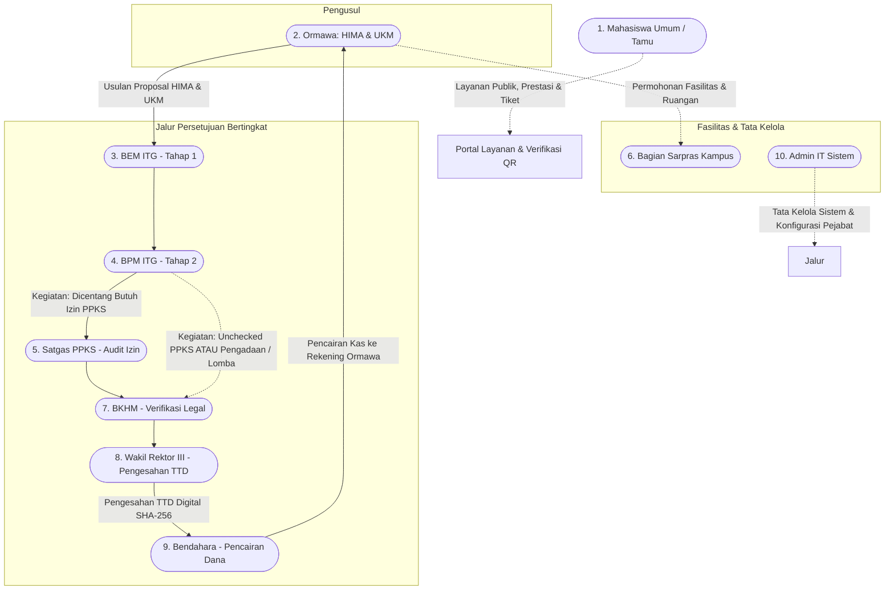

# NASKAH PANDUAN LENGKAP: ALUR PENGGUNAAN FITUR & PENJELASAN DASHBOARD (SKIN ITG)
**Sistem Informasi Kemahasiswaan Terpadu — Institut Teknologi Garut**  
*Panduan Operasional Komprehensif: Dari Mahasiswa Umum, Ormawa (HIMA & UKM), BEM, BPM, Satgas PPKS, Sarpras, BKHM, WR3, Bendahara, hingga Admin IT*

---

## DAFTAR ISI NASKAH PANDUAN
1. [Struktur Ekosistem & Peta Peran Pengguna (10 Aktor)](#1-struktur-ekosistem--peta-peran-pengguna-10-aktor)
2. [Aktor 1: Mahasiswa Umum (Portal Publik & Guest Services)](#2-aktor-1-mahasiswa-umum-portal-publik--guest-services)
   - [2.1 Tampilan & Komponen Dashboard Portal Mahasiswa](#21-tampilan--komponen-dashboard-portal-mahasiswa)
   - [2.2 Naskah Alur Penggunaan Fitur Layanan Mahasiswa](#22-naskah-alur-penggunaan-fitur-layanan-mahasiswa)
3. [Aktor 2: Organisasi Mahasiswa / ORMAWA (HIMA & UKM)](#3-aktor-2-organisasi-mahasiswa--ormawa-hima--ukm)
   - [3.1 Tampilan & Komponen Dashboard Ormawa](#31-tampilan--komponen-dashboard-ormawa)
   - [3.2 Karakteristik & Fokus Khusus HIMA (Dana Non-Akademik & Pelaporan LPJ)](#32-karakteristik--fokus-khusus-hima-dana-non-akademik--pelaporan-lpj)
   - [3.3 Naskah Alur Generator Proposal Otomatis (3 Format Terstandar)](#33-naskah-alur-generator-proposal-otomatis-3-format-terstandar)
   - [3.4 Naskah Alur Pengajuan Proposal: Checkbox Satgas PPKS & Jalur Bypass Otomatis](#34-naskah-alur-pengajuan-proposal-checkbox-satgas-ppks--jalur-bypass-otomatis)
   - [3.5 Naskah Alur Generator 13 Kategori Surat Resmi & Pengamanan Tanda Tangan Ormawa](#35-naskah-alur-generator-13-kategori-surat-resmi--pengamanan-tanda-tangan-ormawa)
   - [3.6 Naskah Alur Peminjaman Sarana & Prasarana Kampus](#36-naskah-alur-peminjaman-sarana--prasarana-kampus)
   - [3.7 Naskah Alur Pelaporan LPJ (3 Template Khusus: Kegiatan, Barang, & Lomba)](#37-naskah-alur-pelaporan-lpj-3-template-khusus-kegiatan-barang--lomba)
4. [Aktor 3: Badan Eksekutif Mahasiswa (BEM)](#4-aktor-3-badan-eksekutif-mahasiswa-bem)
   - [4.1 Tampilan & Komponen Dashboard BEM](#41-tampilan--komponen-dashboard-bem)
   - [4.2 Naskah Alur Verifikasi Tahap 1 Proposal Seluruh Ormawa (HIMA & UKM)](#42-naskah-alur-verifikasi-tahap-1-proposal-seluruh-ormawa-hima--ukm)
   - [4.3 Naskah Alur Kurasi & Publikasi Warta Ormawa](#43-naskah-alur-kurasi--publikasi-warta-ormawa)
   - [4.4 Naskah Alur Penjadwalan Rapat Koordinasi Ormawa](#44-naskah-alur-penjadwalan-rapat-koordinasi-ormawa)
5. [Aktor 4: Badan Perwakilan Mahasiswa (BPM)](#5-aktor-4-badan-perwakilan-mahasiswa-bpm)
   - [5.1 Tampilan & Komponen Dashboard BPM](#51-tampilan--komponen-dashboard-bpm)
   - [5.2 Naskah Alur Verifikasi Tahap 2: Routing Berbasis Checkbox PPKS vs Direct BKHM](#52-naskah-alur-verifikasi-tahap-2-routing-berbasis-checkbox-ppks-vs-direct-bkhm)
   - [5.3 Fitur Monitoring Anggaran Seluruh Organisasi Mahasiswa ITG (`/bpm/anggaran`)](#53-fitur-monitoring-anggaran-seluruh-organisasi-mahasiswa-itg-bpmanggaran)
   - [5.4 Naskah Alur Pengelolaan & Advokasi Aspirasi Kampus](#54-naskah-alur-pengelolaan--advokasi-aspirasi-kampus)
   - [5.5 Naskah Alur Penerbitan Surat Peringatan (SP) Parlemen](#55-naskah-alur-penerbitan-surat-peringatan-sp-parlemen)
6. [Aktor 5: Satuan Tugas Pencegahan & Penanganan Kekerasan Seksual (SATGAS PPKS)](#6-aktor-5-satuan-tugas-ppks)
   - [6.1 Tampilan & Komponen Dashboard Satgas PPKS](#61-tampilan--komponen-dashboard-satgas-ppks)
   - [6.2 Naskah Alur Verifikasi Pakta Integritas Izin Kegiatan](#62-naskah-alur-verifikasi-pakta-integritas-izin-kegiatan)
   - [6.3 Naskah Alur Penerbitan Surat Peringatan (SP) Ganda: Mahasiswa & Ormawa](#63-naskah-alur-penerbitan-surat-peringatan-sp-ganda-mahasiswa--ormawa)
7. [Aktor 6: Bagian Sarana & Prasarana (SARPRAS)](#7-aktor-6-bagian-sarana--prasarana-sarpras)
   - [7.1 Tampilan & Komponen Dashboard Sarpras](#71-tampilan--komponen-dashboard-sarpras)
   - [7.2 Naskah Alur Validasi Peminjaman Ruangan & Jadwal Kuliah Anti-Bentrok](#72-naskah-alur-validasi-peminjaman-ruangan--jadwal-kuliah-anti-bentrok)
   - [7.3 Naskah Alur Peminjaman Barang & Surat Izin Keluar Kampus](#73-naskah-alur-peminjaman-barang--surat-izin-keluar-kampus)
8. [Aktor 7: Biro Kemahasiswaan & Hubungan Alumni (BKHM)](#8-aktor-7-biro-kemahasiswaan--hubungan-alumni-bkhm)
   - [8.1 Tampilan & Komponen Dashboard BKHM (Pusat Kendali Operasional)](#81-tampilan--komponen-dashboard-bkhm)
   - [8.2 Fitur Dashboard Verifikasi Prestasi & Bantuan Delegasi Lomba (`/bkhm/tiket-prestasi`)](#82-fitur-dashboard-verifikasi-prestasi--bantuan-delegasi-lomba-bkhmtiket-prestasi)
   - [8.3 Naskah Alur Verifikasi Kelayakan Administratif Proposal ke WR3](#83-naskah-alur-verifikasi-kelayakan-administratif-proposal-ke-wr3)
   - [8.4 Naskah Alur Alokasi Saldo Pagu & Rekonsiliasi Kas Ormawa](#84-naskah-alur-alokasi-saldo-pagu--rekonsiliasi-kas-ormawa)
   - [8.5 Naskah Alur Verifikasi & Pengesahan LPJ Kegiatan](#85-naskah-alur-verifikasi--pengesahan-lpj-kegiatan)
9. [Aktor 8: Wakil Rektor III Bidang Kemahasiswaan (WR3)](#9-aktor-8-wakil-rektor-iii-bidang-kemahasiswaan-wr3)
   - [9.1 Tampilan & Komponen Dashboard WR3 (Executive Command Center)](#91-tampilan--komponen-dashboard-wr3)
   - [9.2 Naskah Alur Pengesahan Proposal & TTD Digital Kriptografis (SHA-256)](#92-naskah-alur-pengesahan-proposal--ttd-digital-kriptografis-sha-256)
   - [9.3 Aturan Keamanan Tanda Tangan Digital (Security Guard Mahasiswa vs Pimpinan)](#93-aturan-keamanan-tanda-tangan-digital-security-guard-mahasiswa-vs-pimpinan)
   - [9.4 Naskah Alur Validasi & Pengesahan Surat Peringatan Institusional](#94-naskah-alur-validasi--pengesahan-surat-peringatan-institusional)
10. [Aktor 9: Bagian Keuangan / Bendahara Kampus](#10-aktor-9-bagian-keuangan--bendahara-kampus)
    - [10.1 Tampilan & Komponen Dashboard Bendahara](#101-tampilan--komponen-dashboard-bendahara)
    - [10.2 Naskah Alur Pencairan Anggaran Bertahap & Upload Bukti Transfer](#102-naskah-alur-pencairan-anggaran-bertahap--upload-bukti-transfer)
11. [Aktor 10: Administrator Sistem (ADMIN IT)](#11-aktor-10-administrator-sistem-admin-it)
    - [11.1 Tampilan & Komponen Dashboard Admin](#111-tampilan--komponen-dashboard-admin)
    - [11.2 Naskah Alur Manajemen Pengguna, Konfigurasi Pejabat, & Penanganan Bug](#112-naskah-alur-manajemen-pengguna-konfigurasi-pejabat--penanganan-bug)
12. [Rangkuman Matriks Navigasi Cepat (10 Aktor)](#12-rangkuman-matriks-navigasi-cepat-10-aktor)

---

## 1. STRUKTUR EKOSISTEM & PETA PERAN PENGGUNA (10 AKTOR)

Sistem Informasi Kemahasiswaan Terpadu (**SKIN ITG**) mengadopsi prinsip **Role-Based Access Control (RBAC)** mutakhir yang membagi tata kelola kemahasiswaan ke dalam **10 Aktor Terintegrasi**. Sistem telah disederhanakan dengan menghapus peran birokrasi Program Studi (Prodi) pada portal institut, sehingga seluruh ormawa (HIMA dan UKM) memiliki rantai birokrasi yang ramping, transparan, dan terukur.

---

## 2. AKTOR 1: MAHASISWA UMUM (PORTAL PUBLIK & GUEST SERVICES)

Mahasiswa Umum dapat mengakses layanan kampus terpadu secara langsung **tanpa perlu login (Guest Model)** melalui antarmuka portal publik yang responsif, modern, dan ramah seluler.

### 2.1 Tampilan & Komponen Dashboard Portal Mahasiswa (`/` atau `/layanan`)

Ketika mahasiswa membuka portal utama SKIN ITG, dashboard publik menyajikan:
1. **Banner Sambutan & Pencarian Cepat Layanan:** Kolom pencarian interaktif untuk menemukan layanan advokasi, perizinan, dan informasi warta kampus secara instan.
2. **Kartu Pintas 4 Layanan Utama (Interactive Cards):**
   - 📢 **Suara Mahasiswa (Aspirasi):** Akses langsung pengaduan sarana prasarana, fasilitas lab, kurikulum, dan kehidupan kampus.
   - 🛡️ **Layanan Konseling & Advokasi PPKS:** Ruang aman pelaporan kekerasan seksual, perundungan, atau bantuan kesehatan mental mahasiswa.
   - 🏆 **Pelaporan Prestasi Mahasiswa:** Formulir mandiri pencatatan kejuaraan lomba regional/nasional/internasional sekaligus permohonan bantuan dana pembinaan ke BKHM.
   - 🔍 **Lacak Status Tiket Layanan:** Kotak pencarian status penanganan laporan berbasis nomor tiket unik.
3. **Widget Etalase Prestasi Kampus (Showcase):** Galeri bergulir yang menampilkan nama mahasiswa berprestasi ITG, raihan medali/juara, program studi, dan dokumentasi kejuaraan yang telah lolos kurasi resmi.
4. **Pusat Informasi & Warta Ormawa Terkini:** Feed berita kegiatan himpunan/UKM yang sudah dikurasi dan disetujui oleh Kementerian Kominfo BEM.
5. **Widget Verifikasi Dokumen Digital (QR Code Scanner):** Fitur publik untuk memastikan keaslian surat izin kegiatan, surat dispensasi kuliah, atau SK penetapan pejabat kampus tanpa perlu login.

---

### 2.2 Naskah Alur Penggunaan Fitur Layanan Mahasiswa

#### Skenario 1: Menyampaikan Aspirasi / Pengaduan Kampus
1. Mahasiswa mengklik menu **"Kirim Aspirasi"** pada portal publik (`/aspirasi`).
2. Mengisi formulir:
   - **Nama & NIM:** Bersifat opsional jika memilih opsi anonim.
   - **Opsi Rahasia (Centang "Kirim Sebagai Anonim"):** Identitas mahasiswa disamarkan sepenuhnya oleh enkripsi database untuk melindungi pelapor.
   - **Kategori Aspirasi:** Memilih topik (Akademik, Fasilitas/Sarpras, Keuangan, Kebijakan Ormawa, Dosen/Staf).
   - **Judul & Uraian Lengkap:** Menjelaskan kendala secara spesifik.
   - **Unggah Bukti Pendukung:** Lampiran foto atau dokumen format JPG/PNG/PDF (maksimal 5MB).
3. Mengklik tombol **"Kirim Aspirasi Sekarang"**.
4. **Sistem Menghasilkan Nomor Tiket Unik** (contoh: `TK-ASP-202611-0089`). Simpan nomor ini untuk pengecekan berkala.
5. Aspirasi otomatis masuk ke dashboard **BPM (Parlemen Mahasiswa)** untuk ditindaklanjuti.

#### Skenario 2: Melaporkan Prestasi Mahasiswa Mandiri & Permohonan Bantuan Dana Lomba
1. Mahasiswa mengklik tombol **"Lapor Prestasi"** (`/prestasi`).
2. Mengisi data kejuaraan dan delegasi:
   - Nama lengkap mahasiswa & anggota tim (jika delegasi beregu).
   - Program Studi & Angkatan.
   - Nama kompetisi/lomba, penyelenggara, dan tautan informasi lomba resmi.
   - Tingkat kompetisi: Kabupaten/Kota, Provinsi, Nasional (Puspresnas/DIKTI/BPTI), atau Internasional.
   - Capaian juara (Juara 1, 2, 3, Harapan, Best Presentation, dsb.).
   - Unggah berkas wajib: **Scan Sertifikat/Piagam Asli** dan **Foto Dokumentasi Panggung/Trophy**.
3. Klik **"Kirim Laporan Prestasi"**. Sistem menerbitkan nomor tiket `TK-PRS-...`.
4. Berkas otomatis masuk ke **Antrean Khusus Verifikasi Prestasi & Bantuan Lomba di Dashboard BKHM** (`/bkhm/tiket-prestasi`) untuk divalidasi, diberikan dana apresiasi dari pos anggaran kemahasiswaan institut, dan dipublikasikan pada etalase showcase publik.

#### Skenario 3: Memeriksa Status Tiket Layanan (Tracking)
1. Buka menu **"Cek Status Tiket"** (`/tracking` atau `/cek-status`).
2. Masukkan nomor tiket layanan pada kolom yang tersedia (misal: `TK-ASP-202611-0089` atau `TK-PRS-202611-0042`).
3. Klik **"Lacak Progres"**.
4. Sistem menampilkan linimasa status:
   - `Pending` (Laporan Diterima Sistem)
   - `Diproses` (Sedang dalam investigasi / koordinasi BPM & Bagian Terkait)
   - `Selesai` (Telah ditindaklanjuti, dilengkapi pesan tanggapan resmi dari BPM/BKHM).

#### Skenario 4: Verifikasi Keabsahan Dokumen Digital (Anti-Pemalsuan)
1. Mahasiswa, dosen, atau pihak luar membuka halaman **"Verifikasi Dokumen"** (`/verifikasi-dokumen`) atau langsung memindai QR Code pada lembar surat/SK menggunakan kamera ponsel.
2. Sistem mengecek *cryptographic hash token* pada URL.
3. Halaman verifikasi publik menampilkan lembar keabsahan resmi:
   - **Status Dokumen:** `TERVERIFIKASI & SAH SECARA HUKUM` (Badge Hijau Centang).
   - **Nomor Surat & Tanggal Terbit:** Tertera lengkap sesuai database.
   - **Pejabat Penandatangan:** Nama Pejabat (misal: Wakil Rektor III / Ketua Ormawa), NIDN/NIM resmi, dan jabatan.
   - **Stempel Waktu Digital (ISO Timestamp):** Detik presisi saat pengesahan dilakukan.
   - **Ringkasan Hash SHA-256 Dokumen.**

---

## 3. AKTOR 2: ORGANISASI MAHASISWA / ORMAWA (HIMA & UKM)

Ormawa adalah motor penggerak aktivitas mahasiswa di ITG yang terdiri dari **HIMA (Himpunan Mahasiswa Jurusan)** dan **UKM (Unit Kegiatan Mahasiswa)** di tingkat institut.

### 3.1 Tampilan & Komponen Dashboard Ormawa (`/dashboard`)

Dashboard Ormawa dirancang dengan tema *Modern Academic Executive* yang informatif:
1. **5 Kartu Finansial & Operasional Utama:**
   - 🟢 **Sisa Saldo Kas Ormawa (Rp):** Saldo kas riil ormawa yang tersedia dan siap diajukan untuk program kerja berikutnya.
   - 🔵 **Total Pagu Anggaran (Rp):** Plafon pagu alokasi dana yang ditetapkan institut pada periode anggaran berjalan.
   - 🟡 **Dana Terpakai & Diproses (Rp):** Akumulasi dana yang telah disahkan WR3 dan sedang dalam proses pencairan di bendahara.
   - 🟣 **Total Usulan Proposal:** Akumulasi seluruh pengajuan yang pernah dibuat kepengurusan ormawa.
   - 🔴 **Proposal Review Aktif:** Jumlah pengajuan yang saat ini sedang menunggu telaah verifikator (BEM, BPM, Satgas PPKS, BKHM, atau WR3).
2. **Visual Progress Bar Penyerapan Pagu:** Menampilkan persentase perbandingan antara sisa saldo vs anggaran yang telah terealisasi.
3. **Banner Peringatan Tindakan Wajib (Actionable Alerts):**
   - ⚠️ **Peringatan Tunggakan LPJ:** Kotak peringatan jika terdapat kegiatan yang dananya telah dicairkan oleh Bendahara namun belum diunggah LPJ-nya setelah batas waktu 14 hari kalender. Dilengkapi tombol langsung `Unggah LPJ Sekarang`.
   - 🚨 **Pemberitahuan Surat Peringatan (SP) Aktif:** Kotak merah jika ormawa memiliki sanksi administratif aktif dari Parlemen BPM atau Satgas PPKS dengan tombol `Lihat Dokumen Sanksi`.
4. **Widget Kalender Fasilitas & Peminjaman Ruangan Mendatang:** Daftar ruangan gedung kampus yang telah disetujui peminjamannya oleh Sarpras.
5. **Widget Jadwal Rapat Kampus Terdekat:** Kalender koordinasi pimpinan ormawa dengan tautan video conference (Zoom/GMeet).
6. **Tombol Pintas Aksi Cepat (Quick Actions Grid):** Akses instan 1-klik untuk `Buat Pengajuan Baru`, `Generator Proposal`, `Generator Surat Digital`, `Pinjam Sarpras`, dan `Pelaporan LPJ`.

---

### 3.2 Karakteristik & Fokus Khusus HIMA (Dana Non-Akademik & Pelaporan LPJ)

Dalam arsitektur sistem SKIN ITG yang telah disederhanakan:
1. **Peniadaan Peran Prodi di Sistem:** Seluruh urusan kepengurusan ormawa kini terpusat langsung pada institut. Usulan HIMA tidak lagi tertahan di antrean Prodi, melainkan langsung diteruskan ke **BEM** dan **BPM**.
2. **Spesialisasi HIMA untuk Dana Non-Akademik & LPJ:**
   - HIMA difokuskan untuk mengelola pengajuan **Dana Kegiatan Non-Akademik** (seperti malam keakraban, inaugurasi angkatan, seminar kepemimpinan, dan kegiatan non-kurikuler lainnya) serta **Pelaporan LPJ**.
   - Pengajuan anggaran akademik murni dikelola melalui struktur operasional jurusan di luar sistem ormawa kampus, memastikan tidak terjadi tumpang tindih anggaran antara pagu kemahasiswaan institut dan anggaran akademik fakultas.
3. **Rantai Verifikasi Langsung:** Setiap proposal yang dibuat HIMA langsung masuk ke antrean **BEM (Tahap 1)** dengan status awal `SUBMITTED`, menyamakan status dan kecepatan layanan antara HIMA dan UKM.

---

### 3.3 Naskah Alur Generator Proposal Otomatis (3 Format Terstandar)

Ormawa tidak perlu menyusun proposal secara manual di Microsoft Word. Sistem menyediakan mesin pembuat proposal otomatis berstandar baku ITG:
1. Buka menu **"Generator Proposal"** (`/generator/proposal`).
2. Klik **"Buat Proposal Otomatis Baru"**.
3. **Pilih Template Spesifik Sesuai Kebutuhan:**
   - 🎪 **Template Kegiatan Mahasiswa:** Memuat form latar belakang, tema, tujuan, susunan kepanitiaan (Ketua, Sekretaris, Bendahara), target peserta, rundown acara, dan indikator luaran.
   - 📦 **Template Pengadaan Barang:** Memuat form urgensi inventaris ormawa, spesifikasi fisik alat, estimasi masa pakai barang, dan penanggung jawab aset ormawa.
   - 🏆 **Template Pendanaan Lomba:** Memuat daftar delegasi kontingen mahasiswa, dosen pembina/pendamping, profil lomba resmi, serta pos biaya akomodasi, transportasi, dan registrasi kompetisi.
4. **Mengisi Rencana Anggaran Biaya (RAB Dinamis):**
   - Klik **"+ Tambah Item Pos Belanja"**.
   - Masukkan uraian, kuantitas, satuan, dan harga satuan (contoh: *Sewa Sound System - 2 Hari - Rp 500.000*).
   - Subtotal dan total RAB dihitung otomatis oleh sistem dan divalidasi agar tidak melampaui sisa saldo pagu ormawa.
5. Klik **"Simpan & Pratinjau Dokumen"**.
6. Sistem menyusun naskah rapi ber-KOP resmi ormawa, struktur tabel RAB, dan lembar pengesahan.
7. Tersedia tombol **"🚀 Ajukan Dana Resmi"** yang otomatis mentransfer seluruh data kegiatan dan nominal dana ke form pengajuan proposal kampus tanpa perlu mengetik ulang!

---

### 3.4 Naskah Alur Pengajuan Proposal: Checkbox Satgas PPKS & Jalur Bypass Otomatis

#### A. Alur Pengajuan Kategori Kegiatan (Opsi Rekomendasi/Izin Satgas PPKS)
1. Buka menu **"Pengajuan" > "Buat Pengajuan Baru"** (`/pengajuan/create`).
2. Pilih Kategori: **Kegiatan Mahasiswa**.
3. Masukkan nama kegiatan, tanggal mulai, tanggal selesai, lokasi pelaksanaan, dan nominal dana diajukan.
4. **Fitur Checkbox Izin Satgas PPKS (`perlu_satgas_ppks`):**
   - Pada formulir, terdapat kotak interaktif:  
     ☑️ **"Kegiatan Memerlukan Rekomendasi/Izin Satgas PPKS ITG"**
   - **Kapan Harus Dicentang?**  
     Wajib dicentang jika kegiatan melibatkan aktivitas bermalam (*menginap/camping*), kegiatan di luar area kampus (*outdoor/villa*), kegiatan dengan interaksi intensif antar peserta, atau orientasi pengkaderan mahasiswa.
   - **Jika Dicentang:**  
     Formulir akan memunculkan isian dokumen wajib: **Upload Berkas Pakta Integritas / Mitigasi PPKS (PDF)** serta nama narahubung darurat panitia. Proposal ini nantinya akan dialirkan oleh BPM ke **Satgas PPKS** (`PPKS_REVIEW`) untuk audit keamanan sebelum ke BKHM.
   - **Jika Tidak Dicentang (Unchecked - Default):**  
     Untuk kegiatan akademik ringan, webinar online, workshop ruang kelas, atau rapat kerja internal. Proposal akan **melewati (bypass) Satgas PPKS** dan dari BPM langsung melompat ke **BKHM**, memangkas waktu tunggu secara signifikan!
5. **Unggah Dokumen Wajib:** File Proposal Lengkap & RAB (PDF).
6. Klik **"Kirim Pengajuan Proposal"**. Status proposal berubah menjadi `SUBMITTED` dan langsung masuk ke meja verifikasi BEM.

#### B. Alur Pengajuan Kategori Non-Kegiatan (Pengadaan Barang & Pendanaan Lomba - Total Bypass)
1. Buka menu **"Pengajuan" > "Buat Pengajuan Baru"**.
2. Pilih Kategori: **Pengadaan Barang & Inventaris** ATAU **Pendanaan Lomba / Delegasi Kompetisi**.
3. Masukkan judul pengajuan dan nominal anggaran dari tabel RAB.
4. **Keuntungan Jalur Khusus (Total Bypass PPKS):**
   - Kotak checklist dan form instrumen Satgas PPKS otomatis disembunyikan oleh sistem karena tidak melibatkan kerumunan massa fisik.
5. Klik **"Kirim Pengajuan"**.
6. Ketika proposal disetujui BEM dan sampai di meja **BPM**, sistem secara otomatis mengarahkan proposal langsung ke **BKHM** tanpa melewati Satgas PPKS.

---

### 3.5 Naskah Alur Generator 13 Kategori Surat Resmi & Pengamanan Tanda Tangan Ormawa

Ormawa dapat menerbitkan surat dinas resmi dengan nomor surat otomatis, KOP terstandarisasi, dan multi-tanda tangan digital:
1. Buka menu **"Generator Surat"** (`/generator/letters`).
2. Klik **"+ Buat Surat Baru"**.
3. Pilih dari 13 Kategori Surat Resmi ITG:
   - Surat Permohonan Dispensasi Kuliah
   - Surat Peminjaman Ruangan / Tempat
   - Surat Peminjaman Barang / Alat Sarpras
   - Surat Undangan Pembicara / Dosen / Pemateri
   - Surat Permohonan Delegasi Lomba
   - Surat Keterangan Aktif Kepengurusan
   - Surat Rekomendasi Kegiatan
   - Surat Pengantar Proposal
   - Surat Permohonan Kerjasama / Sponsor
   - Surat Pemberitahuan Kegiatan
   - Surat Mandat / Tugas Delegasi
   - Surat Keputusan (SK) Internal Ormawa
   - Surat Peringatan Internal Organisasi
4. Mengisi formulir dinamis sesuai kategori (contoh dispensasi: input nama dosen, mata kuliah, daftar NIM mahasiswa yang meminta izin).
5. **Aturan Keamanan Tanda Tangan Digital (Security Guard):**
   - Sistem secara otomatis membubuhkan **QR Code Tanda Tangan Kriptografis** HANYA bagi pengurus internal mahasiswa (Ketua Umum, Sekretaris Umum, Bendahara, dan Ketua Pelaksana) yang memiliki NIM resmi terverifikasi.
   - Pihak dosen, kaprodi, dekan, pembina ormawa, wakil rektor, dan rektor **TIDAK DAPAT** dibubuhkan tanda tangan otomatis oleh pembuat surat ormawa untuk mencegah celah pemalsuan tanda tangan pejabat kampus.
   - Untuk pimpinan kampus, surat hanya mencetak nama terang, NIDN, dan ruang kosong tanda tangan basah fisik atau harus melalui alur verifikasi resmi sistem.
6. Klik **"Terbitkan Surat"**. Surat siap diunduh berformat PDF resmi ber-QR Code atau dicetak langsung.

---

### 3.6 Naskah Alur Peminjaman Sarana & Prasarana Kampus

1. Buka menu **"Sarpras" > "Peminjaman Tempat"** atau **"Peminjaman Barang"**.
2. **Peminjaman Tempat:**
   - Memilih ruangan (misal: *Aula Rektorat Lt. 3*, *Lab Komputer Jaringan*, *Ruang Kelas C-201*).
   - Memilih tanggal dan jam pemakaian.
   - Sistem secara cerdas melakukan **Deteksi Bentrok Otomatis** dengan jadwal perkuliahan semester dan peminjaman ormawa lain. Jika bertabrakan, sistem menampilkan rincian bentrok dan mencegah reservasi ganda.
   - Mengisi agenda kegiatan dan mengunggah surat permohonan.
3. **Peminjaman Barang:**
   - Memilih barang inventaris (misal: *Proyektor Epson, Kabel Roll, Sound Portable, Mic Wireless*).
   - Memasukkan kuantitas unit dan estimasi tanggal pengembalian.
4. Klik **"Ajukan Peminjaman"**. Permohonan masuk ke antrean **Sarpras** dan **BKHM** untuk verifikasi fisik.

---

### 3.7 Naskah Alur Pelaporan LPJ (3 Template Khusus: Kegiatan, Barang, & Lomba)

Setelah kegiatan terlaksana dan dana dicairkan oleh Bendahara, ormawa memiliki waktu maksimal 14 hari kalender untuk pelaporan:
1. Buka menu **"Pengajuan"**, klik proposal yang berstatus `Dana Dicairkan (FUNDS_DISBURSED)`.
2. Klik tombol **"Unggah LPJ Kegiatan"**.
3. **Sistem Menyesuaikan 3 Template LPJ Spesifik Sesuai Kategori Proposal:**
   - 🎪 **Template LPJ Kegiatan:** Form ringkasan jalannya acara, jumlah peserta riil, kendala teknis lapangan, dokumentasi foto acara, presensi kehadiran, dan nota kuitansi belanja operasional.
   - 📦 **Template LPJ Pengadaan Barang:** Form Berita Acara Serah Terima (BAST) aset, spesifikasi unit fisik yang terbeli, foto kondisi barang, lokasi penempatan/inventaris di sekretariat, dan SOP pemeliharaan alat.
   - 🏆 **Template LPJ Pendanaan Lomba:** Form pencapaian hasil kompetisi (medali/piala), scan sertifikat juara/peserta, foto penyerahan hadiah, serta bukti tiket transportasi, penginapan, dan kwitansi pendaftaran resmi.
4. **Pengembalian Sisa Kas Otomatis:**
   - Jika realisasi belanja lebih kecil dari dana yang dicairkan, sistem secara otomatis menghitung sisa dana kas dan mengembalikannya ke plafon saldo pagu ormawa setelah bukti setor transfer pengembalian diunggah.
5. Klik **"Kirim LPJ"**. Status proposal berubah menjadi `LPJ_SUBMITTED` dan masuk ke meja evaluasi BEM dan BKHM.

---

## 4. AKTOR 3: BADAN EKSEKUTIF MAHASISWA (BEM)

BEM bertindak sebagai koordinator eksekutif seluruh organisasi kemahasiswaan di ITG, bertugas melakukan verifikasi tahap pertama, menyelaraskan kalender kegiatan ormawa, dan mengurasi informasi warta kemahasiswaan kampus.

### 4.1 Tampilan & Komponen Dashboard BEM (`/dashboard`)

1. **Widget Saldo Kas Internal BEM:** Menampilkan pagu alokasi awal BEM, dana yang telah terpakai, dan sisa saldo kas operasional eksekutif.
2. **Kartu Antrean Proposal Masuk (`SUBMITTED`):** Indikator jumlah proposal masuk dari seluruh HIMA dan UKM yang menanti telaah eksekutif tahap pertama.
3. **Widget Agenda Rapat Koordinasi Ormawa:** Daftar rapat pimpinan BEM dengan ketua-ketua himpunan dan UKM.
4. **Widget Kalender Penggunaan Tempat & Fasilitas Kampus Terpadu:** Memantau jadwal pemakaian ruang aula, lapangan, dan gedung serbaguna agar tidak terjadi bentrok antar ormawa.
5. **Pusat Aksi Cepat:** Tautan langsung ke `Verifikasi Proposal`, `Kurasi Berita Ormawa`, dan `Jadwal Rapat`.

---

### 4.2 Naskah Alur Verifikasi Tahap 1 Proposal Seluruh Ormawa (HIMA & UKM)

1. BEM membuka menu **"Verifikasi Proposal"** (`/verifikasi`).
2. Seluruh proposal yang baru diajukan oleh HIMA maupun UKM berstatus `SUBMITTED` tampil pada antrean BEM.
3. Klik judul proposal untuk menelaah:
   - Keselarasan jadwal: Memastikan kegiatan ormawa tidak bertabrakan dengan agenda akbar kampus ITG (Dies Natalis, Wisuda, PKKMB).
   - Relevansi kegiatan dengan visi kemahasiswaan dan pengembangan kapasitas mahasiswa ITG.
   - Kelayakan rancangan kegiatan dan susunan kepanitiaan.
4. **Keputusan Verifikasi BEM:**
   - **Setujui Proposal:** Masukkan catatan telaah, klik tombol hijau **"Setujui & Teruskan ke BPM"**. Status proposal berpindah ke `BEM_APPROVED`.
   - **Minta Revisi:** Klik tombol kuning **"Minta Revisi"** disertai catatan alasan teknis yang harus diperbaiki oleh ormawa pengusul.
   - **Tolak Proposal:** Klik tombol merah **"Tolak Pengajuan"** jika kegiatan bertentangan dengan norma kampus atau dinilai tidak layak.

---

### 4.3 Naskah Alur Kurasi & Publikasi Warta Ormawa

1. Ormawa dapat mengirimkan artikel berita kegiatan atau flyer acara untuk dipajang pada portal publik kampus.
2. Kementerian Kominfo BEM membuka menu **"Kurasi Berita"** (`/kurasi-berita`).
3. Memeriksa draf rilis berita ormawa:
   - Kesesuaian konten tulisan dengan etika jurnalisme kampus dan kaidah bahasa.
   - Kualitas gambar sampul dan kelengkapan tanggal/tempat acara.
4. **Tindakan Kurasi:**
   - Klik **"Setujui & Publikasikan"**: Berita langsung tayang di portal publik mahasiswa (`/informasi`).
   - Klik **"Tolak Berita"** disertai catatan perbaikan jika konten mengandung kesalahan informasi atau unsur komersial liar.

---

### 4.4 Naskah Alur Penjadwalan Rapat Koordinasi Ormawa

1. Buka menu **"Jadwal Rapat"** (`/rapat`).
2. Klik **"+ Buat Jadwal Rapat Baru"**.
3. Mengisi judul rapat, tanggal, jam mulai, lokasi ruangan fisik / tautan video meeting (Zoom/GMeet), serta memilih ormawa yang diundang.
4. Klik **"Terbitkan Jadwal Rapat"**.
5. Undangan rapat otomatis muncul pada widget kalender dashboard seluruh ormawa yang diundang.

---

## 5. AKTOR 4: BADAN PERWAKILAN MAHASISWA (BPM)

BPM adalah lembaga legislatif mahasiswa yang menjalankan fungsi pengawasan anggaran (*budgeting*), pengawasan kinerja (*controlling*), penyaluran aspirasi mahasiswa, serta penegakan tata tertib ormawa.

### 5.1 Tampilan & Komponen Dashboard BPM (`/dashboard`)

1. **Widget Saldo Parlemen BPM:** Pagu anggaran internal legislatif dan penyerapan kas.
2. **Kartu Antrean Proposal Masuk (`BEM_APPROVED`):** Jumlah proposal yang menunggu tinjauan kelayakan anggaran parlemen pada Verifikasi Tahap 2.
3. **Kartu Aspirasi Publik Masuk:** Indikator jumlah tiket keluhan/aspirasi mahasiswa umum dari portal publik yang belum ditindaklanjuti.
4. **Menu Khusus Parlemen Baru:** Akses langsung ke panel **Monitoring Anggaran Seluruh Ormawa** (`/bpm/anggaran`).
5. **Kalender Fasilitas & Agenda Sidang Parlemen:** Jadwal sidang pleno dan audiensi ormawa.

---

### 5.2 Naskah Alur Verifikasi Tahap 2: Routing Berbasis Checkbox PPKS vs Direct BKHM

BPM memegang peranan krusial sebagai *traffic controller* alur verifikasi sistem:
1. BPM membuka menu **"Verifikasi Proposal"** (`/verifikasi`).
2. Membuka berkas pengajuan berstatus `BEM_APPROVED`.
3. Meninjau kepatuhan anggaran: Memeriksa apakah pos belanja RAB wajar dan sesuai dengan plafon anggaran kemahasiswaan ITG.
4. **Pemeriksaan Status Routing Checkbox Satgas PPKS (Otomatis oleh Sistem):**
   - **KASUS 1: Kategori Kegiatan Mahasiswa DENGAN Centang Izin PPKS (`perlu_satgas_ppks = true`)**
     - Sistem mendeteksi ormawa mencentang kebutuhan izin/mitigasi PPKS (kegiatan bermalam/luar kampus/risiko tinggi).
     - Tombol verifikasi yang muncul adalah: **"Setujui & Teruskan ke Satgas PPKS"**.
     - Proposal beralih status ke `PPKS_REVIEW` untuk audit protokol perlindungan oleh Satgas.
   - **KASUS 2: Kategori Kegiatan Mahasiswa TANPA Centang Izin PPKS (`perlu_satgas_ppks = false`)**
     - Sistem mendeteksi kegiatan bersifat rutin/berisiko rendah tanpa interaksi rawan kekerasan.
     - Tombol verifikasi otomatis beralih menjadi: **"Setujui (Langsung ke BKHM)"**.
     - Proposal melompati Satgas PPKS dan langsung beralih ke meja BKHM (`BPM_APPROVED`).
   - **KASUS 3: Kategori Non-Kegiatan (Pengadaan Barang / Pendanaan Lomba)**
     - Sistem mengenali bahwa pengajuan tidak menimbulkan kerumunan massa.
     - Tombol verifikasi otomatis: **"Setujui (Langsung ke BKHM)"** (Bypass Satgas PPKS permanen).
5. Klik tombol persetujuan yang sesuai.

---

### 5.3 Fitur Monitoring Anggaran Seluruh Organisasi Mahasiswa ITG (`/bpm/anggaran`)

Sebagai pemegang fungsi *budgeting & controlling*, BPM dilengkapi instrumen audit anggaran terlengkap:
1. BPM membuka menu navigasi **"Monitoring Anggaran"** (`/bpm/anggaran`).
2. **Dashboard KPI Anggaran Ormawa:**
   - Total Keseluruhan Alokasi Pagu Kampus ITG.
   - Total Realisasi Dana yang Telah Dicairkan.
   - Total Sisa Saldo Kas Ormawa yang Tersisa.
   - Rata-rata Persentase Penyerapan Anggaran (*Absorption Rate*).
3. **Tabel Komparasi Seluruh HIMA & UKM:**
   - Menampilkan daftar lengkap ormawa (BEM, BPM, HIMA Informatika, HIMA Sipil, HIMA Industri, UKM Olahraga, UKM Seni, Pramuka, KSR, dll.).
   - Kolom: Saldo Awal, Total Terpakai, Sisa Saldo, Progress Bar Penyerapan Dana, dan Status Kepatuhan LPJ.
4. **Detail Laporan Keuangan per Ormawa (`/bpm/anggaran/{user}`):**
   - Klik nama ormawa untuk melihat histori proposal yang disetujui, tanggal pencairan dana, serta rekam jejak mutasi kas masuk dan keluar secara rinci.
   - Membantu BPM memberikan rekomendasi alokasi anggaran pada sidang pleno tahunan kampus.

---

### 5.4 Naskah Alur Pengelolaan & Advokasi Aspirasi Kampus

1. BPM membuka menu **"Aspirasi Mahasiswa"** (`/aspirasi`).
2. Menampilkan daftar tiket aspirasi dari mahasiswa umum (baik beridentitas maupun anonim).
3. Mengklik nomor tiket untuk membaca keluhan dan melihat foto bukti kerusakan fasilitas atau keluhan akademik.
4. **Tindak Lanjut Parlemen:**
   - Mengubah status tiket menjadi `Diproses`.
   - Mengisi kolom **Catatan Tindak Lanjut Parlemen** (contoh: *"BPM telah melayangkan nota audiensi ke Kasubag Sarpras terkait perbaikan pendingin ruangan di Gedung C pada 15 November 2026"*).
   - Setelah tuntas diperbaiki, ubah status tiket menjadi `Selesai`.
5. Mahasiswa pelapor dapat langsung melihat pembaruan status ini pada menu tracking publik.

---

### 5.5 Naskah Alur Penerbitan Surat Peringatan (SP) Parlemen

Jika terdapat ormawa yang melanggar AD/ART, mangkir sidang pleno, atau lalai dalam kewajiban organisasi:
1. BPM membuka menu **"Surat Peringatan"** (`/sp`).
2. Klik **"+ Terbitkan SP Parlemen"**.
3. Memilih Ormawa target pelanggaran.
4. Menentukan tingkat: `SP-1` (Teguran Pertama), `SP-2` (Teguran Keras), atau `SP-3` (Rekomendasi Pembekuan).
5. Memasukkan pasal pelanggaran tata tertib dan kronologi temuan legislatif.
6. Klik **"Terbitkan Surat Peringatan"**. Dokumen SP resmi langsung diterbitkan, tercatat di log kepatuhan, dan memicu banner peringatan merah pada dashboard ormawa target.

---

## 6. AKTOR 5: SATUAN TUGAS PENCEGAHAN & PENANGANAN KEKERASAN SEKSUAL (SATGAS PPKS)

Satgas PPKS adalah instrumen resmi universitas yang menjamin seluruh aktivitas kemahasiswaan bebas dari tindak kekerasan seksual, perundungan (*bullying*), dan perpeloncoan fisik.

### 6.1 Tampilan & Komponen Dashboard Satgas PPKS (`/dashboard`)

1. **Kartu Antrean Verifikasi Izin Kegiatan:** Menampilkan proposal kegiatan ormawa berstatus `PPKS_REVIEW` yang dicentang memerlukan rekomendasi/audit perlindungan PPKS.
2. **Kartu Rekap Kegiatan Aman Disetujui (Bulan Ini):** Total kegiatan mahasiswa yang telah tersertifikasi bebas kekerasan seksual.
3. **Pusat Navigasi Khusus:**
   - 🛡️ **Verifikasi Izin & PPKS (`/verifikasi`)**
   - ⚠️ **Surat Peringatan PPKS (`/satgas/sp`)**
   - 🤝 **Layanan Konseling & Pengaduan Rahasia (`/konseling`)**

---

### 6.2 Naskah Alur Verifikasi Pakta Integritas Izin Kegiatan

1. Satgas PPKS membuka menu **"Verifikasi Proposal"** (`/verifikasi`).
2. Membuka proposal kegiatan mahasiswa pada antrean `PPKS_REVIEW`.
3. Mengklik tautan **"Lihat Dokumen Pakta Integritas / Mitigasi PPKS"**:
   - Menilai profil risiko kegiatan: Lokasi kegiatan (*outdoor*/vila/penginapan), rundown malam hari, atau kegiatan kaderisasi.
   - Memastikan panitia menyertakan narahubung darurat independen (putra dan putri).
4. **Tindakan Verifikasi:**
   - **Jika Memenuhi Standar Keamanan:** Klik **"Setujui Verifikasi PPKS"**. Berikan catatan rekomendasi pencegahan. Status proposal diteruskan ke **BKHM** (`PPKS_APPROVED`).
   - **Jika Ditemukan Risiko / Tanpa SOP Perlindungan:** Klik **"Minta Revisi Dokumen PPKS"** dengan catatan wajib melengkapi SOP keamanan kegiatan.

---

### 6.3 Naskah Alur Penerbitan Surat Peringatan (SP) Ganda: Mahasiswa & Ormawa

Fitur penerbitan SP Satgas PPKS telah disempurnakan dengan formulir dinamis yang mendukung dua jenis target penerima sanksi:
1. Satgas PPKS membuka menu **"Surat Peringatan PPKS"** (`/satgas/sp`).
2. Klik tombol **"+ Formulir Usulan Surat Peringatan"** (`/satgas/sp/create`).
3. **Pilih Tipe Sasaran Penerima SP:**
   - 👤 **Mahasiswa Perorangan (Individu):**  
     Untuk kasus pelanggaran kekerasan seksual atau etika yang dilakukan oleh perseorangan. Formulir memfasilitasi penambahan beberapa mahasiswa sekaligus (Nama lengkap dan NIM).
   - 🏛️ **Organisasi Mahasiswa (ORMAWA):**  
     Untuk pelanggaran pakta integritas kelompok, pelaksanaan kegiatan liar tanpa mitigasi, atau pelanggaran etika kelembagaan. Sistem menyajikan daftar dropdown seluruh HIMA dan UKM di ITG.
4. Mengisi Nomor Surat, Tingkat SP (`SP-1`, `SP-2`, atau `SP-3`), Tanggal Surat, Perihal, Ringkasan Pelanggaran, Kronologi Temuan Investigasi Satgas, dan Rekomendasi Sanksi Disiplin.
5. Klik **"Terbitkan & Teruskan ke WR3"**.
6. Usulan SP otomatis diteruskan ke meja **Wakil Rektor III** untuk divalidasi dan disahkan menggunakan Tanda Tangan Digital resmi universitas.
7. Setelah disahkan oleh WR3, Satgas PPKS maupun Ormawa dapat langsung mengunduh salinan **PDF Resmi Surat Peringatan Ber-QR Code** melalui tombol `Unduh PDF`.

---

## 7. AKTOR 6: BAGIAN SARANA & PRASARANA (SARPRAS)

Kasubag Sarpras bertanggung jawab atas ketersediaan fisik aset kampus, ruang kuliah, gedung aula, sound system, serta inventaris kegiatan kemahasiswaan.

### 7.1 Tampilan & Komponen Dashboard Sarpras (`/dashboard`)

1. **Statistik Penggunaan Fasilitas Bulan Ini:** Total peminjaman ruangan dan barang yang sedang aktif.
2. **Antrean Peminjaman Tempat Menunggu Persetujuan:** Daftar pengajuan sewa gedung/kelas dari ormawa.
3. **Antrean Peminjaman Barang Menunggu Persetujuan:** Permohonan alat inventaris kampus.
4. **Kalender Visual Peminjaman Gedung Terpadu:** Menampilkan warna pemakaian ruangan kampus per hari dan jam.

---

### 7.2 Naskah Alur Validasi Peminjaman Ruangan & Jadwal Kuliah Anti-Bentrok

1. Sarpras membuka menu **"Peminjaman Tempat"** (`/peminjaman-tempat`).
2. Membuka permohonan ruangan yang masuk.
3. **Pemeriksaan Anti-Bentrok Otomatis:**
   - Sistem mencocokkan jadwal penggunaan ruang dengan **Database Jadwal Perkuliahan Akademik** dan peminjaman lain.
   - Jika ruangan kosong pada jam yang diajukan, indikator berwarna hijau bertuliskan `Ruangan Tersedia`.
   - Jika ada perkuliahan di ruangan tersebut, sistem menampilkan nama mata kuliah dan dosen pengampu yang sedang aktif.
4. Petugas Sarpras memilih opsi: **Setujui Peminjaman** atau **Alihkan ke Ruangan Alternatif**.
5. Menyetujui surat izin pemakaian fasilitas gedung kampus.

---

### 7.3 Naskah Alur Peminjaman Barang & Surat Izin Keluar Kampus

1. Sarpras membuka menu **"Peminjaman Barang"** (`/peminjaman-barang`).
2. Memeriksa ketersediaan unit barang pada gudang logistik kampus.
3. Meninjau klausul keamanan: Apakah barang boleh dibawa keluar area kampus ITG (*Boleh Dibawa Keluar*).
4. Klik **"Setujui Peminjaman Barang"** dan tentukan batas akhir pengembalian.
5. Sistem menerbitkan **Surat Jalan / Izin Pengambilan Barang** ber-QR Code untuk ditunjukkan ormawa kepada petugas pos satpam.
6. Saat barang dikembalikan utuh, Sarpras mengklik tombol **"Tandai Barang Kembali"** untuk mengembalikan stok aset ke gudang logistik.

---

## 8. AKTOR 7: BIRO KEMAHASISWAAN & HUBUNGAN ALUMNI (BKHM)

BKHM adalah pusat birokrasi universitas yang mengatur status keabsahan ormawa, mengalokasikan plafon dana tahunan, memverifikasi pencatatan prestasi dan permohonan bantuan lomba mahasiswa, serta melakukan peninjauan akhir berkas sebelum diajukan ke Wakil Rektor III.

### 8.1 Tampilan & Komponen Dashboard BKHM (`/dashboard`)

Dashboard BKHM merupakan pusat kendali institusional terlengkap:
1. **Banner Otoritas Sistem Institusi:** Akses cepat ke `Kelola Saldo Pagu`, `Verifikasi Proposal`, dan `Tiket Prestasi`.
2. **7 Kartu Counter Operasional Antrean:**
   - 📝 **Verifikasi Proposal:** Menampilkan proposal siap telaah (dari jalur PPKS maupun bypass langsung BPM).
   - 🏆 **Verifikasi Prestasi & Bantuan Lomba:** Menampilkan tiket pengajuan pencatatan prestasi dan delegasi mahasiswa mandiri.
   - 📑 **Verifikasi LPJ:** Laporan kegiatan yang menunggu audit administrasi.
   - 💰 **Siap Bendahara:** Usulan yang sudah disahkan WR3 dan menunggu pencairan kas.
   - 🏢 **Verifikasi Tempat & 📦 Verifikasi Barang:** Tinjauan peminjaman sarpras kampus.
   - 📰 **Kurasi Berita:** Berita ormawa yang perlu persetujuan publikasi.
3. **Tabel Antrean Verifikasi Prestasi & Bantuan Delegasi Lomba (BKHM):** Tabel antrean terintegrasi langsung di dashboard untuk memproses verifikasi prestasi mahasiswa secara cepat.
4. **Kalender Terpadu Fasilitas Kampus:** Monitoring jadwal pemakaian seluruh fasilitas kampus ITG.
5. **Tabel Histori Mutasi Kas & Rekonsiliasi Saldo Real-Time:** Log setiap alokasi pagu baru, penambahan dana, pemotongan, atau pengembalian saldo kas ormawa.

---

### 8.2 Fitur Dashboard Verifikasi Prestasi & Bantuan Delegasi Lomba (`/bkhm/tiket-prestasi`)

1. BKHM membuka menu **"Tiket Prestasi"** (`/bkhm/tiket-prestasi`) atau mengklik tabel antrean di dashboard.
2. Menampilkan tiket pengajuan dari mahasiswa umum yang berlaga di kejuaraan kompetisi.
3. Klik tiket untuk memeriksa:
   - Nama mahasiswa/kontingen dan Program Studi.
   - Nama lomba, penyelenggara, dan tingkatan (Nasional/Internasional).
   - Bukti keabsahan: Piagam sertifikat asli, foto dokumentasi juara, dan surat tugas.
4. **Tindakan Verifikasi BKHM:**
   - **Setujui & Publikasikan:** Berkas disetujui, prestasi resmi diakui dalam database SIMKATMAWA ITG dan langsung dipajang pada etalase Showcase Prestasi di portal publik.
   - **Rekomendasi Bantuan Dana Delegasi:** BKHM dapat menerbitkan rekomendasi bantuan dana pembinaan kompetisi kepada Wakil Rektor III.

---

### 8.3 Naskah Alur Verifikasi Kelayakan Administratif Proposal ke WR3

1. Staf BKHM membuka menu **"Verifikasi Proposal"** (`/verifikasi`).
2. Menelaah proposal yang telah disetujui BEM & BPM (serta Satgas PPKS jika dicentang):
   - Memastikan legalitas kepengurusan ormawa (memiliki SK aktif yang sah).
   - Memastikan sisa saldo pagu ormawa mencukupi untuk nominal usulan.
   - Memastikan ormawa tidak memiliki tunggakan LPJ pada kegiatan sebelumnya.
3. **Tindakan BKHM:**
   - Klik **"Setujui & Teruskan ke Wakil Rektor III"** (Status berpindah ke `BKHM_APPROVED`).
   - Proposal siap memasuki tahap pengesahan tertinggi di ruang pimpinan universitas.

---

### 8.4 Naskah Alur Alokasi Saldo Pagu & Rekonsiliasi Kas Ormawa

1. Pada awal tahun anggaran, BKHM membuka menu **"Kelola Saldo Ormawa"** (`/bkhm/saldo`).
2. Menampilkan daftar seluruh ormawa (BEM, BPM, HIMA Informatika, HIMA Sipil, UKM Seni, Pramuka, dll.).
3. Klik tombol **"Atur Saldo"** pada ormawa yang dituju:
   - Memilih jenis aksi: **Set Saldo Awal (Pagu Baru)**, **Tambah Saldo (Hibah/Tambahan)**, atau **Koreksi Saldo**.
   - Memasukkan nominal rupiah (misal: *Rp 15.000.000*).
   - Memasukkan catatan audit wajib (contoh: *"Alokasi DIPA Anggaran Kemahasiswaan TA 2026/2027"*).
4. Klik **"Simpan Perubahan Saldo"**. Sistem mencatat transaksi pada tabel audit `saldo_histori` lengkap dengan stempel waktu dan identitas staf BKHM penanggung jawab.

---

### 8.5 Naskah Alur Verifikasi & Pengesahan LPJ Kegiatan

1. BKHM membuka tab **"Verifikasi LPJ"** pada menu verifikasi.
2. Membuka berkas LPJ yang diunggah ormawa (disesuaikan dengan template Kegiatan, Pengadaan Barang, atau Delegasi Lomba).
3. Mencocokkan kuitansi dan nota belanja asli dengan nominal yang dicairkan oleh Bendahara.
4. Jika terdapat kelebihan dana yang dikembalikan, memastikan bukti setor kas universitas terlampir.
5. Klik **"Setujui & Sahkan LPJ"**.
6. Status kegiatan otomatis ditutup (`COMPLETED`), arsip digital tersimpan, dan blokir pengajuan ormawa resmi dicabut.

---

## 9. AKTOR 8: WAKIL REKTOR III BIDANG KEMAHASISWAAN (WR3)

Wakil Rektor III adalah pejabat pimpinan tertinggi penentu kebijakan kemahasiswaan ITG, dengan otoritas legalitas final persetujuan anggaran dan penandatangan Tanda Tangan Digital Kriptografis sah.

### 9.1 Tampilan & Komponen Dashboard WR3 (`/dashboard`)

Dashboard WR3 dirancang khusus untuk pimpinan eksekutif (*Executive Command Center*):
1. **Banner Eksekutif Sambutan Pimpinan:** Ringkasan peran sebagai otoritas tertinggi kemahasiswaan.
2. **Ringkasan Pagu Saldo per Kategori Organisasi:** Menampilkan perbandingan alokasi pagu vs serapan dana antara BEM, BPM, kelompok Himpunan Mahasiswa (HIMA), dan kelompok Unit Kegiatan Mahasiswa (UKM).
3. **Kartu Antrean Verifikasi Proposal Final (`BKHM_APPROVED`):** Jumlah proposal yang siap disahkan dan dibiayai.
4. **Kartu Validasi Surat Peringatan (SP):** Usulan SP kasus kedisiplinan mahasiswa dari Satgas PPKS atau BPM yang membutuhkan pengesahan pimpinan.
5. **Widget Agenda Rapat Pimpinan & Koordinasi Kemahasiswaan.**
6. **Log Audit Riwayat Mutasi Anggaran Kampus.**

---

### 9.2 Naskah Alur Pengesahan Proposal & TTD Digital Kriptografis (SHA-256)

1. Wakil Rektor III membuka menu **"Verifikasi Proposal"** (`/verifikasi`).
2. Membuka proposal yang masuk pada tahap akhir (`BKHM_APPROVED`).
3. Meninjau lembar rekomendasi dari BEM, BPM, Satgas PPKS (jika ada), dan BKHM.
4. Meninjau rincian nominal dana yang dimohonkan.
5. **Proses Pengesahan & Pembubuhan Tanda Tangan Digital:**
   - WR3 mengklik tombol hijau **"Setujui & Terbitkan SK / Pengesahan Dana"**.
   - **Mekanisme Kriptografis Sistem (Di Balik Layar):**
     1. Sistem merangkai payload otentikasi: `Nama WR3 + NIDN + Waktu Stempel Presisi ISO + Token Proposal`.
     2. Sistem menghasilkan kode hash enkripsi **SHA-256 Signature**.
     3. Sistem menggenerasikan lembar pengesahan resmi ber-KOP ITG lengkap dengan **QR Code Digital Signature**.
     4. Data status proposal otomatis berpindah ke `TO_TREASURER` (Siap Dicairkan).
6. Dokumen proposal kini sah secara hukum dan Bagian Keuangan menerima instruksi pencairan dana.

---

### 9.3 Aturan Keamanan Tanda Tangan Digital (Security Guard Mahasiswa vs Pimpinan)

Sistem menerapkan protokol keamanan tanda tangan digital bertingkat yang ketat:
1. **Tanda Tangan Pengurus Mahasiswa (NIM Based):**
   - Pengurus ormawa (Ketua, Sekretaris, Bendahara, Panitia) yang menerbitkan surat atau proposal internal akan mendapatkan QR Code tanda tangan digital otomatis berbasis identitas NIM yang terdaftar.
2. **Proteksi Anti-Pemalsuan Pejabat Kampus (Institutional Guard):**
   - Mahasiswa atau ormawa **DILARANG KERAS dan TIDAK DAPAT** membubuhkan QR tanda tangan otomatis atas nama Dosen, Pembina, Ketua Program Studi, Dekan, Wakil Rektor, maupun Rektor pada dokumen yang mereka generate secara mandiri.
   - Tanda tangan pimpinan (WR3/Rektor) HANYA dapat diterbitkan secara resmi melalui sistem ketika akun pejabat yang bersangkutan masuk ke portal dan mengklik tombol pengesahan resmi berpassword.
   - Dokumen permohonan surat biasa yang ditujukan ke dosen/pembina dicetak menggunakan format tanda tangan basah fisik atau divalidasi lewat verifikasi QR resmi universitas.

---

### 9.4 Naskah Alur Validasi & Pengesahan Surat Peringatan Institusional

1. WR3 membuka menu **"Validasi Surat Peringatan"** (`/wr3/surat-peringatan`).
2. Menampilkan draf usulan sanksi dari Satgas PPKS (kasus etika/pelecehan) atau BPM/BKHM (kasus pelanggaran tata tertib ormawa).
3. WR3 meninjau berkas berita acara pemeriksaan dan kronologi temuan.
4. Mengklik tombol **"Sahkan & Bubuhkan Tanda Tangan Digital"**.
5. Surat Peringatan resmi universitas diterbitkan dengan nomor surat institusi dan QR Code verifikasi keabsahan hukum.
6. Sanksi pembatasan hak atau evaluasi kepengurusan langsung aktif pada sistem bagi mahasiswa atau ormawa target penerima.

---

## 10. AKTOR 9: BAGIAN KEUANGAN / BENDAHARA KAMPUS

Bendahara adalah pengelola kas operasional yang bertugas mencairkan anggaran riil ke rekening resmi ormawa berdasarkan keputusan sah Wakil Rektor III.

### 10.1 Tampilan & Komponen Dashboard Bendahara (`/dashboard`)

1. **Kartu Statistik Siap Cair:** Jumlah proposal yang telah berstatus `TO_TREASURER` (disahkan WR3) dan siap ditransfer dananya.
2. **Kartu Total Dana Telah Dicairkan:** Akumulasi nominal rupiah yang telah berhasil dicairkan ke seluruh ormawa pada periode anggaran aktif.
3. **Tabel Antrean Proposal Siap Cair:** Rincian proposal mencakup nama ormawa, nama kegiatan, bank tujuan, nomor rekening ormawa, nama pemilik rekening, dan nominal pencairan.
4. **Tabel Riwayat Pencairan Dana:** Arsip histori transfer dilengkapi tautan bukti transfer perbankan.

---

### 10.2 Naskah Alur Pencairan Anggaran Bertahap & Upload Bukti Transfer

1. Bendahara membuka menu **"Pencairan Dana"** (`/verifikasi` atau `/dana`).
2. Memilih proposal yang siap dicairkan dari tabel antrean.
3. Memeriksa keabsahan nomor rekening bank ormawa yang terdaftar pada profil ormawa.
4. **Menentukan Mekanisme Pencairan (Termin):**
   - **Pencairan Sekaligus (100%):** Untuk kegiatan nominal mendesak atau pengadaan barang langsung.
   - **Pencairan Bertahap (Termin 1 & Termin 2):** Misalnya 70% di awal kegiatan untuk operasional, dan 30% setelah draf LPJ awal diserahkan.
5. Melakukan transfer via sistem perbankan kampus ke rekening resmi ormawa.
6. **Input Realisasi Pencairan pada Sistem:**
   - Memasukkan nominal yang ditransfer (misal: *Rp 7.000.000*).
   - Memasukkan tanggal transfer dan nomor referensi bank.
   - Mengunggah **Bukti Transfer Bank (Slip ATM / Resi M-Banking / Mutasi Rekening)** format PDF/JPG.
7. Klik **"Simpan & Konfirmasi Pencairan"**.
8. Status proposal otomatis beralih menjadi `FUNDS_DISBURSED` (Dana Dicairkan).
9. Akun ormawa menerima notifikasi bahwa dana telah masuk ke rekening mereka dan tenggat waktu 14 hari unggah LPJ mulai dihitung mundur.

---

## 11. AKTOR 10: ADMINISTRATOR SISTEM (ADMIN IT)

Administrator memegang kendali teknis infrastruktur aplikasi, master data kampus, pemeliharaan hak akses 10 role pengguna, dan konfigurasi pejabat penandatangan.

### 11.1 Tampilan & Komponen Dashboard Admin (`/dashboard`)

1. **Kartu Statistik Total Pengguna:** Jumlah akun terdaftar yang aktif pada sistem.
2. **Pusat Manajemen Master Data:** Akses ke master ruangan gedung, master barang, konfigurasi jabatan pimpinan, dan log aktivitas sistem.
3. **Pusat Pemantauan Bug / Tiket Kendala Teknis:** Memantau laporan kendala yang dikirimkan oleh pengguna melalui tombol `Lapor Bug` di header.

---

### 11.2 Naskah Alur Manajemen Pengguna, Konfigurasi Pejabat, & Penanganan Bug

#### A. Membuat Akun Ormawa / Pejabat Baru
1. Masuk ke menu **"Manajemen Pengguna"** (`/admin/users`).
2. Klik tombol **"+ Tambah Pengguna Baru"**.
3. Memasukkan nama lengkap, email, username, dan password awal.
4. **Memilih Role Akses Spesifik (10 Role):**
   - Jika `ormawa`: Pilih jenis ormawa (*HIMA* atau *UKM*), isi nomor rekening resmi, dan lampirkan file SK Kepengurusan (PDF).
   - Jika `bem` / `bpm` / `satgas_ppks` / `sarpras` / `bkhm` / `wr3` / `bendahara`: Akun otomatis diberi hak verifikasi dan fitur sesuai otoritas tugasnya.
5. Klik **"Simpan Pengguna"**.

#### B. Mengubah Pejabat Penandatangan Kampus
1. Masuk ke menu **"Konfigurasi Pejabat"** (`/admin/konfigurasi/edit`).
2. Memperbarui identitas pejabat jika terjadi pergantian kepemimpinan di ITG:
   - Nama Rektor, NIDN, dan file stempel digital.
   - Nama Wakil Rektor III, NIDN, dan tanda tangan resmi.
   - Nama Kepala BKHM dan Kasubag Sarpras.
3. Klik **"Simpan Konfigurasi"**. Seluruh generator surat dan lembar pengesahan otomatis menggunakan identitas pejabat baru.

#### C. Menindaklanjuti Laporan Bug / Kendala Teknis
1. Masuk ke menu **"Laporan Bug"** (`/laporan-bug`).
2. Membaca deskripsi kendala dari pengguna beserta tangkapan layar (*screenshot*) yang dilampirkan.
3. Mengubah status laporan menjadi `Sedang Diperbaiki` lalu `Tuntas`.

---

## 12. RANGKUMAN MATRIKS NAVIGASI CEPAT (10 AKTOR)

| Aktor / Peran | URL Dashboard Utama | Fitur Kunci / Alur Utama | Hak Verifikasi Utama |
|---|---|---|---|
| **Mahasiswa Umum** | `/` atau `/layanan` | Kirim Aspirasi Publik, Lapor Prestasi & Minta Bantuan Lomba, Konseling PPKS, Tracking Tiket, Cek Keaslian Dokumen QR | Publik (Tanpa Login) |
| **Ormawa (HIMA/UKM)** | `/dashboard` | Usulan Proposal Dana (Checkbox PPKS), Generator Proposal (3 Format), Generator 13 Surat Resmi, Pinjam Sarpras, Pelaporan LPJ (3 Template) | Membuat & Mengajukan |
| **BEM** | `/dashboard` & `/verifikasi` | Verifikasi Tahap 1 Seluruh Ormawa (HIMA & UKM), Kurasi Berita Ormawa, Kalender Rapat Koordinasi | Seluruh Ormawa (Tahap 1) |
| **BPM** | `/dashboard` & `/verifikasi` | Verifikasi Tahap 2 (Routing Checkbox PPKS vs Direct BKHM), **Monitoring Anggaran Ormawa (`/bpm/anggaran`)**, Tindak Lanjut Aspirasi, Terbitkan SP | Seluruh Ormawa (Tahap 2) |
| **Satgas PPKS** | `/dashboard` & `/verifikasi` | Audit Pakta Integritas Izin Kegiatan Berisiko, Penerbitan SP Ganda (Mahasiswa & Ormawa), Layanan Konseling | Izin Kegiatan Berisiko PPKS |
| **Sarpras** | `/dashboard` & `/peminjaman-tempat` | Validasi Jadwal Ruangan Anti-Bentrok Perkuliahan, Izin Peminjaman Barang & Surat Jalan Keluar Kampus, Kalender Gedung | Fasilitas Fisik & Logistik |
| **BKHM** | `/dashboard` & `/bkhm` | Verifikasi Legal Administrasi ke WR3, **Dashboard Verifikasi Prestasi & Bantuan Lomba (`/bkhm/tiket-prestasi`)**, Alokasi Pagu & Rekonsiliasi Kas, Pengesahan 3 LPJ | Kelayakan Dokumen Kampus |
| **WR3** | `/dashboard` & `/verifikasi` | Pengesahan Akhir Proposal, Tanda Tangan Digital Kriptografis (SHA-256 + QR), Validasi & Sahkan Surat Peringatan Resmi | Otoritas Tertinggi Kampus |
| **Bendahara** | `/dashboard` & `/dana` | Pencairan Anggaran Bertahap (Termin 1 & 2), Upload Bukti Transfer Bank, Rekening Kas Kemahasiswaan | Pencairan Kas Riil |
| **Admin IT** | `/dashboard` & `/admin` | Tata Kelola 10 Role Pengguna, Konfigurasi Pejabat Kampus & Master Data, Penanganan Laporan Bug | Tata Kelola Sistem & DB |

---
*Dokumen Naskah ini resmi diterbitkan sebagai Panduan Operasional Standar (SOP) & Manual Pengguna Sistem Informasi Kemahasiswaan Terpadu (SKIN ITG) — Institut Teknologi Garut 2026.*
