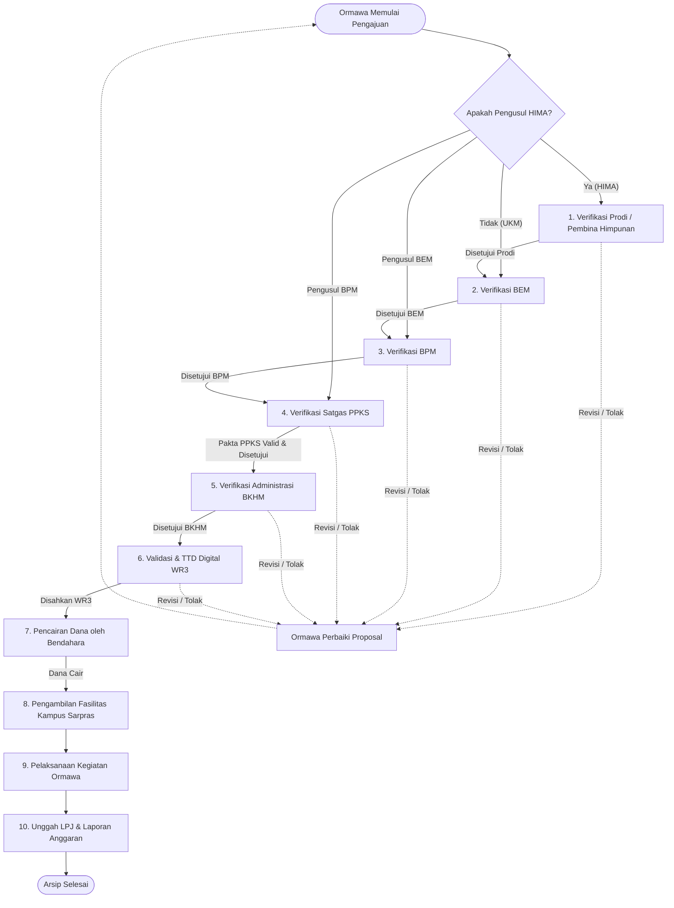
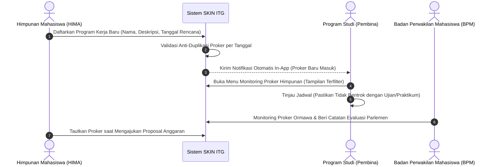
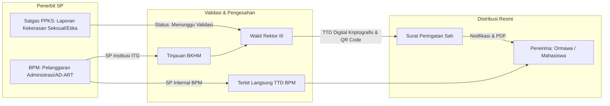
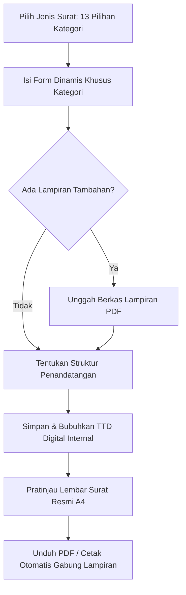

# MODUL PANDUAN ALUR DAN PENGGUNAAN SISTEM (SKIN ITG)
**Sistem Informasi Kemahasiswaan, Tata Kelola Ormawa, Persuratan Digital, dan Layanan Publik**  
*Institut Teknologi Garut — Versi Mutakhir 2026*

---

## DAFTAR ISI
1. [Pendahuluan & Arsitektur Peran (10 Aktor Sistem)](#1-pendahuluan--arsitektur-peran)
2. [Matriks Hak Akses & Kewenangan (RBAC Matrix)](#2-matriks-hak-akses--kewenangan)
3. [Alur Bisnis Utama (Workflow) & Diagram Alur](#3-alur-bisnis-utama--diagram-alur)
   - [3.1 Alur Pengajuan Proposal & Izin Kegiatan (Versi 2 Terpadu)](#31-alur-pengajuan-proposal--izin-kegiatan-versi-2)
   - [3.2 Alur Monitoring Program Kerja & Notifikasi Prodi](#32-alur-monitoring-program-kerja--notifikasi-prodi)
   - [3.3 Alur Penindakan & Surat Peringatan (SP) Satgas PPKS & BPM](#33-alur-penindakan--surat-peringatan-sp)
   - [3.4 Alur Generator Persuratan Digital (13 Kategori Surat)](#34-alur-generator-persuratan-digital-13-kategori)
   - [3.5 Alur Pencairan Anggaran & Rekonsiliasi Saldo Pagu](#35-alur-pencairan-anggaran--rekonsiliasi-saldo)
   - [3.6 Alur Pelaporan Pertanggungjawaban (LPJ) & Pengarsipan](#36-alur-pelaporan-pertanggungjawaban-lpj)
   - [3.7 Alur Peminjaman Sarana Prasarana (Anti-Bentrok)](#37-alur-peminjaman-sarana-prasarana)
   - [3.8 Alur Layanan Publik Mahasiswa Bertiket (Guest Model)](#38-alur-layanan-publik-mahasiswa-bertiket)
4. [Panduan Langkah demi Langkah Penggunaan per Role](#4-panduan-penggunaan-per-role)
   - [4.1 Panduan Ormawa (HIMA & UKM)](#41-panduan-ormawa-hima--ukm)
   - [4.2 Panduan Program Studi (Prodi / Pembina Himpunan)](#42-panduan-program-studi-prodi)
   - [4.3 Panduan Satgas PPKS](#43-panduan-satgas-ppks)
   - [4.4 Panduan Badan Eksekutif Mahasiswa (BEM)](#44-panduan-badan-eksekutif-mahasiswa-bem)
   - [4.5 Panduan Badan Perwakilan Mahasiswa (BPM)](#45-panduan-badan-perwakilan-mahasiswa-bpm)
   - [4.6 Panduan Biro Kemahasiswaan (BKHM)](#46-panduan-biro-kemahasiswaan-bkhm)
   - [4.7 Panduan Wakil Rektor III (WR3)](#47-panduan-wakil-rektor-iii-wr3)
   - [4.8 Panduan Bendahara (Bagian Keuangan)](#48-panduan-bendahara-bagian-keuangan)
   - [4.9 Panduan Sarana & Prasarana (Sarpras)](#49-panduan-sarana--prasarana-sarpras)
   - [4.10 Panduan Administrator Sistem (Admin / IT)](#410-panduan-administrator-sistem-admin)
5. [Daftar Kredensial Uji Coba Default (Development / Testing)](#5-daftar-kredensial-uji-coba-default)
6. [Tanya Jawab & Pemecahan Masalah (Troubleshooting)](#6-tanya-jawab--pemecahan-masalah)

---

## 1. PENDAHULUAN & ARSITEKTUR PERAN

Sistem Informasi Kemahasiswaan Terpadu (**SKIN ITG**) adalah platform tata kelola kelembagaan mahasiswa Institut Teknologi Garut yang mengintegrasikan pengajuan anggaran berbasis saldo riil, pengawasan program kerja, verifikasi izin pencegahan kekerasan seksual, peminjaman sarana prasarana anti-bentrok, persuratan otomatis, serta pengesahan digital ber-QR Code dengan tanda tangan kriptografis.

### 10 Aktor / Role Sistem:
1. **ORMAWA (HIMA & UKM):** Organisasi kemahasiswaan pelaksana kegiatan, penyusun rencana program kerja, pembuat surat, dan pengelola anggaran pagu.
2. **PRODI (Program Studi):** Dosen Pembina / Ketua Program Studi yang mengawasi rencana program kerja himpunan mahasiswa serta melakukan peninjauan akademik pada proposal HIMA.
3. **BEM (Badan Eksekutif Mahasiswa):** Lembaga eksekutif mahasiswa yang memvalidasi relevansi kegiatan ormawa dengan kalender mahasiswa dan mengkurasi warta ormawa.
4. **BPM (Badan Perwakilan Mahasiswa):** Lembaga legislatif mahasiswa yang mengawasi anggaran, memonitor proker tahunan, mengelola aspirasi publik, dan menerbitkan Surat Peringatan (SP) internal/reguler.
5. **SATGAS PPKS:** Satuan Tugas Pencegahan & Penanganan Kekerasan Seksual yang memverifikasi dokumen pakta integritas izin kegiatan bebas kekerasan seksual serta berwenang menerbitkan Surat Peringatan sanksi etika kemahasiswaan.
6. **BKHM (Biro Kemahasiswaan & Hubungan Alumni):** Lembaga pengelola administrasi legalitas ormawa, kurasi SK kepengurusan, verifikasi tempat, dan jembatan ke pimpinan universitas.
7. **WR3 (Wakil Rektor III Bidang Kemahasiswaan):** Otoritas tertinggi persetujuan proposal dan pengesahan Surat Peringatan universitas melalui pembubuhan Tanda Tangan Digital Kriptografis sah.
8. **BENDAHARA (Bagian Keuangan):** Otoritas verifikasi pencairan dana riil ke rekening ormawa bertahap dan pencatat histori mutasi kas.
9. **SARPRAS (Sarana & Prasarana):** Otoritas persetujuan peminjaman ruangan, gedung, dan barang kampus dengan kalender jadwal anti-bentrok.
10. **ADMIN (Administrator Sistem / IT):** Pengelola akun pengguna, konfigurasi pejabat universitas, dan penanganan tiket bug teknis sistem.

---

## 2. MATRIKS HAK AKSES & KEWENANGAN

| Modul / Fitur | Ormawa | Prodi | BEM | BPM | Satgas PPKS | BKHM | WR3 | Bendahara | Sarpras | Admin |
|---|:---:|:---:|:---:|:---:|:---:|:---:|:---:|:---:|:---:|:---:|
| **Buat & Edit Proposal** | ✅ | ❌ | ✅ | ✅ | ❌ | ❌ | ❌ | ❌ | ❌ | ❌ |
| **Review Proposal HIMA (Tahap 1)** | ❌ | ✅ | ❌ | ❌ | ❌ | ❌ | ❌ | ❌ | ❌ | ❌ |
| **Review Ormawa (Tahap 2 & 3)** | ❌ | ❌ | ✅ | ✅ | ❌ | ❌ | ❌ | ❌ | ❌ | ❌ |
| **Verifikasi Dokumen Izin PPKS** | ❌ | ❌ | ❌ | ❌ | ✅ | ❌ | ❌ | ❌ | ❌ | ❌ |
| **Verifikasi Administrasi BKHM** | ❌ | ❌ | ❌ | ❌ | ❌ | ✅ | ❌ | ❌ | ❌ | ❌ |
| **Persetujuan & TTD Digital WR3** | ❌ | ❌ | ❌ | ❌ | ❌ | ❌ | ✅ | ❌ | ❌ | ❌ |
| **Pencairan Dana Bertahap** | ❌ | ❌ | ❌ | ❌ | ❌ | ❌ | ❌ | ✅ | ❌ | ❌ |
| **Peminjaman Fasilitas/Sarpras** | ✅ | ❌ | ✅ | ✅ | ❌ | Review | ❌ | ❌ | Approve | ❌ |
| **Monitoring Program Kerja** | Input | View HIMA | View All | View All | ❌ | View All | View All | ❌ | ❌ | View All |
| **Penerbitan Surat Peringatan (SP)** | ❌ | ❌ | ❌ | ✅ (BPM) | ✅ (PPKS) | Review | Approve | ❌ | ❌ | View All |
| **Generator 13 Kategori Surat** | ✅ | ❌ | ✅ | ✅ | ❌ | ❌ | ❌ | ❌ | ❌ | ❌ |
| **Pelaporan LPJ Kegiatan** | ✅ | ❌ | ✅ | ✅ | ❌ | Review | ❌ | ❌ | ❌ | ❌ |
| **Manajemen Pengguna & Saldo** | ❌ | ❌ | ❌ | ❌ | ❌ | ✅ | ❌ | ❌ | ❌ | ✅ |

---

## 3. ALUR BISNIS UTAMA & DIAGRAM ALUR

### 3.1 Alur Pengajuan Proposal & Izin Kegiatan (Versi 2 Terpadu)

Setiap kegiatan ormawa wajib memenuhi legalitas administratif, kesesuaian prodi (khusus himpunan), pengawasan perwakilan mahasiswa, serta **audit dokumen izin kegiatan bebas kekerasan seksual oleh Satgas PPKS** sebelum disahkan oleh Wakil Rektor III dan dicairkan oleh Bagian Keuangan.

#### Rincian Dokumen Wajib per Pengajuan:
1. **Draf Proposal Kegiatan (PDF):** Latar belakang, tujuan, susunan acara, dan struktur panitia.
2. **Rencana Anggaran Biaya (RAB):** Terperinci per pos belanja (tidak boleh melebihi sisa saldo pagu tahunan ormawa).
3. **Dokumen Pakta Integritas / Izin PPKS (PDF):** Komitmen kepatuhan anti-kekerasan seksual, anti-perpeloncoan, dan etika kegiatan kampus.
4. **Surat Rekomendasi / Pengantar (Opsional):** Rekomendasi dari pihak eksternal atau mitra kerja sama.

---

### 3.2 Alur Monitoring Program Kerja & Notifikasi Prodi

Program Kerja (Proker) adalah rencana tahunan yang diajukan oleh ormawa di awal masa kepengurusan.

---

### 3.3 Alur Penindakan & Surat Peringatan (SP)

Penegakan tata tertib kemahasiswaan dan etika kampus dilakukan melalui dua pintu penindakan resmi: **BPM** (parlemen mahasiswa) dan **Satgas PPKS** (penegak norma etika dan anti-kekerasan seksual).

* **Tingkat Sanksi:**
  * `SP-1`: Peringatan tertulis pertama dan teguran administrasi.
  * `SP-2`: Peringatan tertulis kedua, pembatasan fasilitas, dan evaluasi kepengurusan.
  * `SP-3`: Peringatan keras terakhir, rekomendasi skorsing kegiatan, atau pencabutan status kepengurusan.

---

### 3.4 Alur Generator Persuratan Digital (13 Kategori Surat)

Sistem menyediakan generator surat cerdas dengan layout KOP otomatis organisasi (terhubung ke profil ormawa), multi-signer digital, dan auto-merge lampiran berkas PDF.

---

### 3.5 Alur Pencairan Anggaran & Rekonsiliasi Saldo

1. **Pagu Anggaran Awal:** Setiap ormawa diberikan pagu saldo awal pada periode anggaran aktif oleh Admin/BKHM.
2. **Kunci Saldo Saat Diajukan:** Total RAB proposal yang diajukan akan divalidasi tidak boleh melebihi sisa saldo.
3. **Pencairan oleh Bendahara:** Setelah disetujui WR3, Bendahara memverifikasi nomor rekening dan bukti transfer bank, lalu menandai status pencairan (misal: Bertahap 70% di awal dan 30% pasca-kegiatan).
4. **Audit Trail Mutasi Saldo:** Seluruh penyesuaian saldo (penambahan, koreksi, atau pemotongan) tercatat pada tabel histori audit yang tidak dapat dimanipulasi.

---

### 3.6 Alur Pelaporan Pertanggungjawaban (LPJ) & Pengarsipan

1. Pasca kegiatan selesai, Ormawa wajib mengunggah **Laporan Pertanggungjawaban (LPJ)** maksimal 14 hari kerja.
2. Ormawa mengisi realisasi pos belanja vs RAB awal, kendala kegiatan, dan mengunggah kuitansi/bukti transaksi asli.
3. BEM dan BKHM memverifikasi LPJ.
4. Setelah disetujui, LPJ otomatis masuk ke **Arsip Persuratan Digital Kampus** dan sisa dana yang tidak terpakai dikembalikan ke kas.

---

## 4. PANDUAN PENGGUNAAN PER ROLE

### 4.1 Panduan Ormawa (HIMA & UKM)
* **Membuat Proposal Baru:**
  1. Masuk ke menu **Pengajuan > Buat Pengajuan**.
  2. Pilih jenis organisasi (`HIMA` atau `UKM`).
  3. Isi nama kegiatan, tanggal rencana, dan pilih program kerja terkait.
  4. Unggah draf proposal kegiatan dan berkas **Dokumen Izin / Pakta Integritas Bebas Kekerasan Seksual (PPKS)**.
  5. Masukkan rincian pos anggaran (RAB) dan periksa batas saldo pagu.
  6. Klik **Ajukan Proposal**.
* **Membuat Surat Resmi (Generator Surat):**
  1. Masuk ke menu **Generator Surat > Buat Surat**.
  2. Pilih salah satu dari 13 kategori surat (misal: *Surat Permohonan Dispensasi Kuliah*).
  3. Masukkan data mahasiswa (bisa menambah banyak mahasiswa delegasi), perihal, dan tanggal.
  4. Pilih penandatangan (Ketua, Sekretaris, atau Pembina).
  5. Klik **Buat Surat & Tanda Tangan**.
  6. Klik **Unduh PDF** atau **Cetak**.
* **Mendaftarkan Program Kerja:**
  1. Masuk ke menu **Program Kerja > Tambah Proker Baru**.
  2. Isi nama proker, deskripsi, dan target tanggal pelaksanaan.
  3. Klik **Simpan**. (Jika Anda HIMA, Prodi Anda otomatis menerima notifikasi).

---

### 4.2 Panduan Program Studi (Prodi / Pembina Himpunan)
* **Memverifikasi Proposal HIMA:**
  1. Masuk ke menu **Verifikasi Himpunan** (`/verifikasi`).
  2. Sistem hanya menampilkan proposal dari HIMA jurusan Anda.
  3. Klik **Periksa Detail** untuk membaca berkas proposal dan dokumen izin PPKS.
  4. Tinjau kesesuaian tanggal dengan jadwal perkuliahan prodi.
  5. Jika sesuai, bubuhkan catatan persetujuan lalu klik **Setujui & Teruskan ke BEM**.
  6. Jika terdapat bentrok jadwal atau kekurangan berkas, klik **Kembalikan untuk Revisi**.
* **Monitoring Program Kerja Jurusan:**
  1. Masuk ke menu **Monitoring Proker Himpunan** (`/proker`).
  2. Pantau seluruh rencana kegiatan HIMA sepanjang tahun ajaran aktif.

---

### 4.3 Panduan Satgas PPKS
* **Memverifikasi Dokumen Izin Bebas Kekerasan Seksual:**
  1. Masuk ke menu **Verifikasi Izin & PPKS** (`/verifikasi`).
  2. Buka proposal kegiatan mahasiswa yang masuk pada antrean PPKS.
  3. Klik tombol **Buka Pakta Integritas / Dokumen PPKS** untuk memeriksa komitmen panitia, kesiapan mitigasi risiko kegiatan (terutama kegiatan di luar kampus / menginap).
  4. Klik **Setujui Verifikasi PPKS** untuk menandatangani secara digital dan meneruskan proposal ke BKHM.
* **Menerbitkan Surat Peringatan (SP):**
  1. Masuk ke menu **Surat Peringatan PPKS** (`/satgas/sp`).
  2. Klik **Terbitkan SP Baru**.
  3. Pilih tipe sasaran: **Mahasiswa Perorangan** (bisa input banyak mahasiswa sekaligus) atau **Organisasi Mahasiswa (ORMAWA)**.
  4. Pilih tingkat peringatan (`SP-1`, `SP-2`, atau `SP-3`).
  5. Tuliskan perihal, ringkasan pelanggaran, kronologi temuan investigasi Satgas, dan rekomendasi sanksi disiplin.
  6. Klik **Terbitkan & Teruskan ke WR3**. Surat akan otomatis masuk ke antrean validasi Wakil Rektor III.

---

### 4.4 Panduan Badan Eksekutif Mahasiswa (BEM)
* Masuk ke menu **Verifikasi Proposal**.
* Tinjau urgensi kegiatan, keselarasan visi kemahasiswaan, dan tidak adanya bentrok waktu dengan agenda akbar kampus.
* Setujui untuk meneruskan ke BPM, atau kembalikan dengan catatan perbaikan.

---

### 4.5 Panduan Badan Perwakilan Mahasiswa (BPM)
* **Verifikasi Proposal:** Masuk ke menu verifikasi untuk meninjau kepatuhan anggaran terhadap regulasi parlemen mahasiswa.
* **Penerbitan Surat Peringatan Parlemen:** Masuk ke menu **Kelola BPM > Riwayat Surat Peringatan**. Klik **Terbitkan SP Baru** untuk menindak pelanggaran kepengurusan ormawa atau anggota internal BPM.

---

### 4.6 Panduan Biro Kemahasiswaan (BKHM)
* Memeriksa kelayakan administratif institusi, legalitas SK ormawa, dan ketersediaan alokasi universitas.
* Meninjau usulan SP reguler sebelum diteruskan ke pimpinan universitas.
* Mengelola kalender kegiatan dan arsip persuratan digital kampus.

---

### 4.7 Panduan Wakil Rektor III (WR3)
* **Validasi Akhir Proposal:** Masuk ke menu verifikasi proposal untuk memberikan keputusan final institusi.
* **Pengesahan Tanda Tangan Digital Kriptografis:**
  1. Saat WR3 menyetujui, sistem membuat *hash cryptographic payload* SHA-256 yang memuat nama pejabat, NIDN, jabatan, dan stempel waktu ISO.
  2. QR Code verifikasi publik otomatis disematkan pada lembar pengesahan resmi.
* **Pengesahan Surat Peringatan:** Masuk ke menu **WR3 > Validasi Surat Peringatan** (`/wr3/surat-peringatan`) untuk memeriksa draf SP dari Satgas PPKS atau BKHM/BPM, lalu klik **Setujui & Bubuhkan TTD Digital**.

---

### 4.8 Panduan Bendahara (Bagian Keuangan)
* Masuk ke menu **Pencairan Dana** (`/verifikasi`).
* Periksa nomor rekening ormawa, nominal dana yang disetujui WR3, dan input bukti transfer bank.
* Perbarui status pencairan agar ormawa dapat mencairkan dana kegiatan.

---

### 4.9 Panduan Sarana & Prasarana (Sarpras)
* Masuk ke menu **Verifikasi Sarpras**.
* Tinjau ketersediaan ruangan melalui fitur pengecekan bentrok jadwal perkuliahan.
* Setujui peminjaman tempat / fasilitas dan terbitkan surat izin pemakaian fasilitas kampus.

---

### 4.10 Panduan Administrator Sistem (Admin / IT)
* **Membuat Akun Baru:**
  1. Masuk ke menu **Manajemen Pengguna** (`/admin/users`).
  2. Klik **+ Tambah Pengguna**.
  3. Pilih Role Akses yang diinginkan:
     * Jika memilih `PRODI`: Pilih Program Studi (Teknik Informatika, Sistem Informasi, Teknik Sipil, Teknik Industri, Arsitektur) dan kode prodi.
     * Jika memilih `SATGAS PPKS`: Sistem menandai akun sebagai pengawas PPKS resmi.
     * Jika memilih `ORMAWA`: Tentukan jenis ormawa (`HIMA` atau `UKM`), pilih prodi asal jika HIMA, dan lampirkan berkas SK kepengurusan resmi (PDF).
  4. Klik **Simpan**.
* **Atur Saldo Ormawa:** Klik tombol **Atur Saldo** pada akun ormawa untuk menambah atau mengoreksi pagu anggaran tahunan disertai alasan pencatatan audit.

---

## 5. DAFTAR KREDENSIAL UJI COBA DEFAULT

Gunakan akun-akun berikut untuk menguji seluruh skenario alur pada lingkungan lokal (`http://127.0.0.1:8000`):

| Role | Username | Password | Keterangan / Prodi |
|---|---|---|---|
| **Administrator** | `admin` | `password` | Super Admin Sistem |
| **BKHM** | `bkhm` | `password` | Biro Kemahasiswaan & Alumni |
| **Wakil Rektor III** | `wr3` | `password` | Pimpinan Pengesahan Akhir |
| **Satgas PPKS** | `satgas_ppks` | `password` | Verifikator Izin & Penerbit SP PPKS |
| **Prodi Informatika** | `prodi_if` | `password` | Pembina Himpunan Mahasiswa IF |
| **BEM ITG** | `bem` | `password` | Badan Eksekutif Mahasiswa |
| **BPM ITG** | `bpm` | `password` | Badan Perwakilan Mahasiswa |
| **Bendahara** | `bendahara` | `password` | Bagian Keuangan Kampus |
| **Sarpras** | `sarpras` | `password` | Pengelola Fasilitas & Ruangan |
| **HIMATIF (HIMA IF)** | `himatif` | `password` | Ormawa Himpunan Teknik Informatika |
| **UKM Seni (UKM)** | `ukm_seni` | `password` | Unit Kegiatan Mahasiswa |

---

## 6. TANYA JAWAB & PEMECAHAN MASALAH (TROUBLESHOOTING)

* **Q: Mengapa akun Prodi tidak melihat proposal dari UKM Musik atau BEM?**  
  *A:* Sesuai aturan bisnis, Prodi hanya bertindak sebagai Pembina bagi Himpunan Mahasiswa (HIMA) di bawah jurusannya sendiri. UKM dan BEM langsung diverifikasi oleh tingkat institut (BEM, BPM, PPKS, BKHM, WR3).

* **Q: Dokumen apa yang wajib diunggah saat verifikasi PPKS?**  
  *A:* Berkas pakta integritas dan lembar komitmen kegiatan bebas dari kekerasan seksual, perpeloncoan, dan diskriminasi. Berkas wajib berformat PDF.

* **Q: Bagaimana jika proposal salah input dan ingin diperbaiki mandiri oleh Ormawa?**  
  *A:* Selama proposal masih berada pada tahap awal (antrean Prodi / BEM / BPM), pengusul dapat menggunakan tombol **Batalkan Pengajuan** untuk merevisi berkas secara mandiri tanpa mencemari log penolakan.

* **Q: Bagaimana cara memverifikasi keaslian Tanda Tangan Digital pada dokumen cetak?**  
  *A:* Setiap dokumen yang telah disahkan memiliki QR Code unik. Pindai (*scan*) QR Code tersebut menggunakan kamera ponsel untuk membuka halaman verifikasi kriptografis publik yang menampilkan keabsahan SHA-256 dan identitas resmi pejabat penandatangan.

---
*Dokumen ini diterbitkan oleh Tim Pengembang Sistem Informasi Kemahasiswaan Terpadu (SKIN ITG) — Hak Cipta © 2026 Institut Teknologi Garut.*
