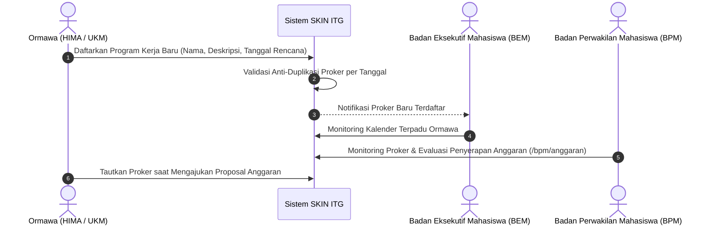
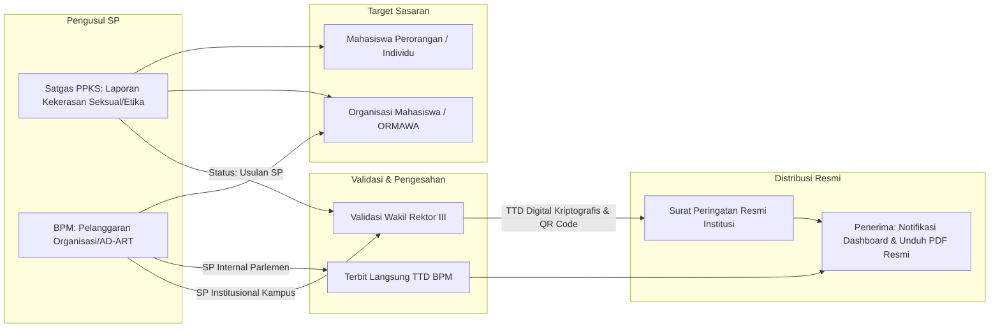
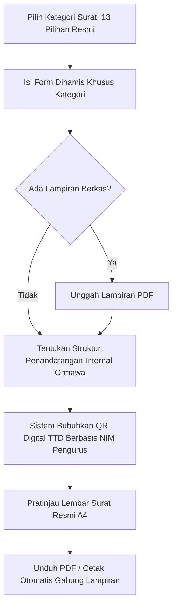

# MODUL PANDUAN ALUR DAN PENGGUNAAN SISTEM (SKIN ITG)
**Sistem Informasi Kemahasiswaan, Tata Kelola Ormawa, Persuratan Digital, dan Layanan Publik**  
*Institut Teknologi Garut — Versi Mutakhir 2026*

---

## DAFTAR ISI
1. [Pendahuluan & Arsitektur Peran (10 Aktor Sistem)](#1-pendahuluan--arsitektur-peran)
2. [Matriks Hak Akses & Kewenangan (RBAC Matrix)](#2-matriks-hak-akses--kewenangan)
3. [Alur Bisnis Utama (Workflow) & Diagram Alur](#3-alur-bisnis-utama--diagram-alur)
   - [3.1 Alur Pengajuan Proposal & Izin Kegiatan (Checkbox Satgas PPKS & Jalur Bypass)](#31-alur-pengajuan-proposal--izin-kegiatan)
   - [3.2 Alur Program Kerja Ormawa & Monitoring Parlemen](#32-alur-program-kerja-ormawa--monitoring-parlemen)
   - [3.3 Alur Penindakan & Surat Peringatan (SP) Satgas PPKS & BPM](#33-alur-penindakan--surat-peringatan-sp)
   - [3.4 Alur Generator Persuratan Digital (13 Kategori) & Security Guard TTD](#34-alur-generator-persuratan-digital-13-kategori)
   - [3.5 Alur Pencairan Anggaran & Rekonsiliasi Saldo Pagu](#35-alur-pencairan-anggaran--rekonsiliasi-saldo)
   - [3.6 Alur Pelaporan Pertanggungjawaban (LPJ - 3 Format Template)](#36-alur-pelaporan-pertanggungjawaban-lpj)
   - [3.7 Alur Peminjaman Sarana Prasarana (Anti-Bentrok)](#37-alur-peminjaman-sarana-prasarana)
   - [3.8 Alur Layanan Publik Mahasiswa Bertiket (Guest Model & Tiket Prestasi)](#38-alur-layanan-publik-mahasiswa-bertiket)
4. [Panduan Langkah demi Langkah Penggunaan per Role](#4-panduan-penggunaan-per-role)
   - [4.1 Panduan Ormawa (HIMA & UKM)](#41-panduan-ormawa-hima--ukm)
   - [4.2 Panduan Mahasiswa Umum (Portal Publik & Tamu)](#42-panduan-mahasiswa-umum-portal-publik)
   - [4.3 Panduan Satgas PPKS](#43-panduan-satgas-ppks)
   - [4.4 Panduan Badan Eksekutif Mahasiswa (BEM)](#44-panduan-badan-eksekutif-mahasiswa-bem)
   - [4.5 Panduan Badan Perwakilan Mahasiswa (BPM)](#45-panduan-badan-perwakilan-mahasiswa-bpm)
   - [4.6 Panduan Biro Kemahasiswaan (BKHM)](#46-panduan-biro-kemahasiswaan-bkhm)
   - [4.7 Panduan Wakil Rektor III (WR3)](#47-panduan-wakil-rektor-iii-wr3)
   - [4.8 Panduan Bendahara (Bagian Keuangan)](#48-panduan-bendahara-bagian-keuangan)
   - [4.9 Panduan Sarana & Prasarana (Sarpras)](#49-panduan-sarana--prasarana-sarpras)
   - [4.10 Panduan Administrator Sistem (Admin / IT)](#410-panduan-administrator-sistem-admin)
5. [Daftar Kredensial Uji Coba Default (Development / Testing)](#5-daftar-kredensial-uji-coba-default)
6. [Tanya Jawab & Pemecahan Masalah (Troubleshooting)](#6-tanya-jawab--pemecahan-masalah)

---

## 1. PENDAHULUAN & ARSITEKTUR PERAN

Sistem Informasi Kemahasiswaan Terpadu (**SKIN ITG**) adalah platform tata kelola kelembagaan mahasiswa Institut Teknologi Garut yang mengintegrasikan pengajuan anggaran berbasis saldo riil, pengawasan program kerja, verifikasi izin pencegahan kekerasan seksual, peminjaman sarana prasarana anti-bentrok, persuratan otomatis, verifikasi prestasi mandiri, serta pengesahan digital ber-QR Code dengan tanda tangan kriptografis sah.

Struktur sistem telah disederhanakan dengan meniadakan peran birokrasi Program Studi (Prodi) pada aplikasi, sehingga seluruh pengajuan organisasi mahasiswa (HIMA maupun UKM) memiliki alur yang ramping langsung ke tingkat institut.

### 10 Aktor / Role Sistem:
1. **ORMAWA (HIMA & UKM):** Organisasi kemahasiswaan pelaksana kegiatan, penyusun rencana program kerja, pembuat surat dinas, pelapor LPJ, dan pengelola anggaran pagu riil. (Khusus HIMA difokuskan pada dana kegiatan non-akademik dan pelaporan LPJ).
2. **BEM (Badan Eksekutif Mahasiswa):** Lembaga eksekutif mahasiswa yang memvalidasi relevansi kegiatan seluruh ormawa pada Verifikasi Tahap 1, menyelaraskan kalender ormawa, dan mengurasi warta kemahasiswaan.
3. **BPM (Badan Perwakilan Mahasiswa):** Lembaga legislatif mahasiswa yang melakukan Verifikasi Tahap 2, mengarahkan alur Satgas PPKS vs Bypass BKHM, mengawasi serapan anggaran seluruh ormawa (`/bpm/anggaran`), mengadvokasi aspirasi publik, dan menerbitkan Surat Peringatan (SP) parlemen.
4. **SATGAS PPKS:** Satuan Tugas Pencegahan & Penanganan Kekerasan Seksual yang memverifikasi pakta integritas/mitigasi risiko kegiatan mahasiswa berisiko serta berwenang menerbitkan Surat Peringatan sanksi etika bagi Mahasiswa Perorangan maupun Organisasi Mahasiswa (ORMAWA).
5. **SARPRAS (Sarana & Prasarana):** Otoritas validasi ketersediaan ruangan dan peminjaman fasilitas kampus dengan sistem deteksi bentrok jadwal kuliah akademik otomatis.
6. **BKHM (Biro Kemahasiswaan & Hubungan Alumni):** Lembaga pengelola administrasi legalitas ormawa, alokasi saldo pagu, verifikasi tiket pelaporan prestasi & bantuan delegasi lomba mahasiswa mandiri (`/bkhm/tiket-prestasi`), serta audit 3 format LPJ.
7. **WR3 (Wakil Rektor III Bidang Kemahasiswaan):** Otoritas tertinggi persetujuan proposal dan pengesahan Surat Peringatan universitas melalui pembubuhan Tanda Tangan Digital Kriptografis SHA-256 sah ber-QR Code.
8. **BENDAHARA (Bagian Keuangan):** Otoritas eksekusi pencairan dana riil ke rekening resmi ormawa bertahap (termin) dan pencatat histori mutasi perbankan.
9. **ADMIN (Administrator Sistem / IT):** Pengelola akun pengguna 10 role, konfigurasi identitas pejabat universitas, master data fasilitas, dan penanganan tiket kendala teknis (bug).
10. **MAHASISWA UMUM (Portal Publik & Tamu):** Mahasiswa ITG yang mengakses portal layanan tanpa login untuk menyampaikan aspirasi (bisa anonim), melapor prestasi mandiri & mengajukan bantuan lomba, serta memverifikasi keaslian dokumen QR Code.

---

## 2. MATRIKS HAK AKSES & KEWENANGAN

| Modul / Fitur | Ormawa | Mahasiswa | BEM | BPM | Satgas PPKS | Sarpras | BKHM | WR3 | Bendahara | Admin |
|---|:---:|:---:|:---:|:---:|:---:|:---:|:---:|:---:|:---:|:---:|
| **Buat & Edit Proposal** | ✅ | ❌ | ✅ | ✅ | ❌ | ❌ | ❌ | ❌ | ❌ | ❌ |
| **Review Ormawa (Tahap 1 BEM)** | ❌ | ❌ | ✅ | ❌ | ❌ | ❌ | ❌ | ❌ | ❌ | ❌ |
| **Review Anggaran (Tahap 2 BPM)** | ❌ | ❌ | ❌ | ✅ | ❌ | ❌ | ❌ | ❌ | ❌ | ❌ |
| **Monitoring Anggaran Semua Ormawa** | Saldo Sendiri | ❌ | ❌ | ✅ (`/bpm/anggaran`) | ❌ | ❌ | ✅ (Pagu) | View All | ❌ | View All |
| **Verifikasi Dokumen Izin PPKS** | ❌ | ❌ | ❌ | ❌ | ✅ (Jika dicentang) | ❌ | ❌ | ❌ | ❌ | ❌ |
| **Verifikasi Administrasi BKHM** | ❌ | ❌ | ❌ | ❌ | ❌ | ❌ | ✅ | ❌ | ❌ | ❌ |
| **Verifikasi Prestasi & Bantuan Lomba**| ❌ | Lapor Mandiri | Kurasi | ❌ | ❌ | ❌ | ✅ (Tiket) | Rekomendasi | ❌ | ❌ |
| **Persetujuan & TTD Digital WR3** | ❌ | ❌ | ❌ | ❌ | ❌ | ❌ | ❌ | ✅ (SHA-256) | ❌ | ❌ |
| **Pencairan Dana Bertahap** | ❌ | ❌ | ❌ | ❌ | ❌ | ❌ | ❌ | ❌ | ✅ | ❌ |
| **Peminjaman Fasilitas Sarpras** | ✅ | ❌ | ✅ | ✅ | ❌ | Approve | Review | ❌ | ❌ | ❌ |
| **Penerbitan Surat Peringatan (SP)** | ❌ | ❌ | ❌ | ✅ (BPM) | ✅ (PPKS) | ❌ | Review | Sahkan TTD | ❌ | View All |
| **Generator 13 Kategori Surat** | ✅ | ❌ | ✅ | ✅ | ❌ | ❌ | ❌ | ❌ | ❌ | ❌ |
| **Pelaporan LPJ (3 Template)** | ✅ | ❌ | Review | Review | ❌ | ❌ | Approve | ❌ | ❌ | ❌ |
| **Manajemen Pengguna & Konfigurasi** | ❌ | ❌ | ❌ | ❌ | ❌ | ❌ | Saldo | ❌ | ❌ | ✅ |

---

## 3. ALUR BISNIS UTAMA & DIAGRAM ALUR

### 3.1 Alur Pengajuan Proposal & Izin Kegiatan

Setiap kegiatan ormawa (HIMA maupun UKM) diajukan langsung melalui BEM dan BPM. Pada formulir pengajuan terdapat kendali routing pintar berbasis checkbox izin Satgas PPKS:

```mermaid
flowchart TD
    Start([Ormawa Mengajukan Proposal]) --> StepBEM[1. Verifikasi Tahap 1: BEM ITG]
    StepBEM -->|Disetujui BEM| StepBPM[2. Verifikasi Tahap 2: BPM ITG]
    
    StepBPM --> CekCheckbox{Apakah Kategori Kegiatan & Dicentang 'Perlu Izin Satgas PPKS'?}
    
    CekCheckbox -- Ya (Dicentang) --> StepPPKS[3. Verifikasi Audit Izin: Satgas PPKS]
    StepPPKS -->|Pakta & SOP Disetujui| StepBKHM[4. Verifikasi Kelayakan: BKHM]
    
    CekCheckbox -- Tidak (Unchecked / Pengadaan / Lomba) -->|Jalur Bypass Otomatis| StepBKHM
    
    StepBKHM -->|Disetujui BKHM| StepWR3[5. Pengesahan & TTD Digital SHA-256: WR3]
    StepWR3 -->|Disahkan WR3| StepBendahara[6. Pencairan Kas Bertahap: Bendahara]
    StepBendahara -->|Dana Cair| Pelaksanaan[7. Pelaksanaan Kegiatan / Realisasi Belanja]
    Pelaksanaan --> StepLPJ[8. Unggah LPJ Berdasarkan 3 Template Spesifik]
    StepLPJ --> Selesai([Audit Selesai & Kas Rekonsiliasi])
    
    StepBEM -.->|Revisi / Tolak| OrmawaRevisi[Ormawa Perbaiki Proposal]
    StepBPM -.->|Revisi / Tolak| OrmawaRevisi
    StepPPKS -.->|Revisi / Tolak| OrmawaRevisi
    StepBKHM -.->|Revisi / Tolak| OrmawaRevisi
    StepWR3 -.->|Revisi / Tolak| OrmawaRevisi
    OrmawaRevisi -.-> Start
```

#### Ketentuan Routing Jalur Proposal:
1. **Kegiatan dengan Centang Izin PPKS (`perlu_satgas_ppks = true`):**
   - Wajib dicentang untuk kegiatan bermalam (*camping/menginap*), kegiatan di luar kampus (*outdoor/villa*), atau kaderisasi mahasiswa.
   - Wajib melampirkan berkas Pakta Integritas / Mitigasi PPKS.
   - Diarahkan oleh BPM ke antrean **Satgas PPKS** (`PPKS_REVIEW`) sebelum ke BKHM.
2. **Kegiatan Tanpa Centang Izin PPKS (`perlu_satgas_ppks = false` - Default):**
   - Kegiatan rutin berisiko rendah (webinar, rapat kerja, seminar kelas).
   - Dari BPM langsung melompat ke antrean **BKHM** (`BPM_APPROVED`), melewati Satgas PPKS.
3. **Pengadaan Barang & Pendanaan Lomba:**
   - Secara permanen melewati (bypass) Satgas PPKS karena tidak melibatkan kerumunan massa fisik.

---

### 3.2 Alur Program Kerja Ormawa & Monitoring Parlemen

Program Kerja (Proker) adalah cetak biru kegiatan ormawa selama satu periode kepengurusan.



---

### 3.3 Alur Penindakan & Surat Peringatan (SP)

Penegakan tata tertib kemahasiswaan dan etika kampus dilakukan melalui dua pintu penindakan resmi: **BPM** (pelanggaran AD/ART dan administrasi) serta **Satgas PPKS** (pelanggaran etika, perundungan, dan kekerasan seksual).



* **Tingkat Sanksi:**
  * `SP-1`: Peringatan tertulis pertama dan teguran administratif.
  * `SP-2`: Peringatan tertulis kedua, pembatasan fasilitas, dan evaluasi kepengurusan.
  * `SP-3`: Peringatan keras terakhir, rekomendasi skorsing kegiatan, atau pembekuan kepengurusan ormawa.

---

### 3.4 Alur Generator Persuratan Digital (13 Kategori) & Security Guard TTD

Sistem menyediakan generator surat cerdas berstandar ITG dengan KOP otomatis, penomoran terpadu, dan multi-signer:



* **Security Guard TTD Digital (Proteksi Pemalsuan):**
  * Tanda tangan digital otomatis berbasis QR Code HANYA berlaku bagi pengurus internal mahasiswa (Ketua, Sekretaris, Bendahara, Panitia) yang memiliki identitas NIM resmi.
  * Mahasiswa dan ormawa **TIDAK DAPAT** membubuhkan QR tanda tangan otomatis atas nama Dosen, Kaprodi, Dekan, Pembina, WR3, maupun Rektor pada dokumen yang dibuat mandiri. Pimpinan hanya dapat menandatangani melalui login akun pejabat resmi di portal atau tanda tangan basah fisik.

---

### 3.5 Alur Pencairan Anggaran & Rekonsiliasi Saldo Pagu

1. **Alokasi Pagu Awal:** Setiap ormawa diberikan plafon saldo kas awal oleh BKHM pada pembukaan tahun anggaran.
2. **Validasi Saldo:** Nominal RAB yang diajukan divalidasi sistem agar tidak melebihi sisa saldo kas aktif ormawa.
3. **Pencairan oleh Bendahara:** Setelah proposal disahkan WR3 (`TO_TREASURER`), Bendahara mentransfer dana ke rekening ormawa secara bertahap (termin) dan mengunggah slip transfer.
4. **Audit Trail Mutasi Saldo:** Saldo kas otomatis terpotong saat dana dicairkan dan seluruh pergerakan kas tercatat pada log mutasi rekonsiliasi yang tidak dapat diubah.

---

### 3.6 Alur Pelaporan Pertanggungjawaban (LPJ - 3 Format Template)

Pasca kegiatan terlaksana, ormawa wajib mengunggah LPJ maksimal 14 hari kalender. Sistem menyediakan 3 template khusus:
1. 🎪 **Template LPJ Kegiatan:** Ringkasan pelaksanaan acara, jumlah peserta riil, evaluasi teknis lapangan, dokumentasi foto, presensi kehadiran, dan nota belanja operasional.
2. 📦 **Template LPJ Pengadaan Barang:** Berita Acara Serah Terima (BAST) aset, spesifikasi fisik unit, foto kondisi barang, lokasi penempatan di sekretariat, dan SOP perawatan alat.
3. 🏆 **Template LPJ Pendanaan Lomba:** Rekapitulasi kontingen delegasi (NIM & prodi), hasil kejuaraan (medali/trofi), scan piagam penghargaan, serta kuitansi akomodasi, transportasi, dan pendaftaran lomba.
4. **Pengembalian Sisa Kas:** Jika terdapat sisa dana lebih, sistem menghitung sisa kas dan mengembalikannya ke pagu ormawa setelah bukti setor bank diunggah.

---

### 3.7 Alur Peminjaman Sarana Prasarana (Anti-Bentrok)

1. Ormawa mengajukan peminjaman ruangan gedung atau alat kampus melalui menu Sarpras.
2. **Mesin Anti-Bentrok Otomatis:** Sistem mencocokkan tanggal dan jam pemakaian dengan jadwal perkuliahan semester dan reservasi ormawa lain.
3. Petugas Sarpras memvalidasi ketersediaan fisik lalu menyetujui izin peminjaman.
4. Sistem menerbitkan Surat Izin Pemakaian Fasilitas / Surat Jalan Pengambilan Barang ber-QR Code untuk ditunjukkan ke petugas keamanan kampus.

---

### 3.8 Alur Layanan Publik Mahasiswa Bertiket (Guest Model & Tiket Prestasi)

1. Mahasiswa umum dapat menyampaikan aspirasi (dengan opsi anonim) atau melaporkan kasus ke Satgas PPKS tanpa login.
2. **Pelaporan Prestasi & Bantuan Lomba Mandiri:** Mahasiswa melaporkan capaian lomba mandiri untuk diverifikasi oleh BKHM (`/bkhm/tiket-prestasi`) dan dipajang pada etalase Showcase Prestasi publik.
3. Setiap pengajuan menghasilkan nomor tiket unik (contoh: `TK-ASP-...`, `TK-PRS-...`) untuk dipantau perkembangannya pada menu Lacak Status Tiket.

---

## 4. PANDUAN PENGGUNAAN PER ROLE

### 4.1 Panduan Ormawa (HIMA & UKM)
* **Membuat Proposal Baru:**
  1. Masuk ke menu **Pengajuan > Buat Pengajuan** (`/pengajuan/create`).
  2. Pilih Kategori: *Kegiatan Mahasiswa*, *Pengadaan Barang*, atau *Pendanaan Lomba*.
  3. Masukkan nama usulan, tanggal pelaksanaan, dan nominal anggaran RAB.
  4. **Perhatikan Kotak Centang Satgas PPKS:**
     * Centang *"Kegiatan Memerlukan Rekomendasi/Izin Satgas PPKS ITG"* jika kegiatan menginap, diadakan di luar kampus, atau berisiko tinggi. Unggah berkas Pakta Integritas PPKS.
     * Biarkan tidak tercentang jika kegiatan rutin/berisiko rendah (proposal langsung melewati jalur cepat bypass Satgas PPKS ke BKHM).
  5. Unggah naskah proposal PDF & RAB.
  6. Klik **Kirim Pengajuan**. Proposal langsung masuk ke antrean BEM dengan status `SUBMITTED`.
* **Menggunakan Generator Proposal (3 Format):**
  1. Masuk ke menu **Generator Proposal** (`/generator/proposal`).
  2. Pilih template (*Kegiatan*, *Barang*, atau *Lomba*).
  3. Isi form dinamis dan item belanja RAB.
  4. Klik **Simpan & Pratinjau**, lalu klik **Ajukan Dana Resmi** untuk transfer data otomatis ke form pengajuan.
* **Membuat Surat Resmi (Generator 13 Surat):**
  1. Masuk ke menu **Generator Surat** (`/generator/letters`).
  2. Pilih jenis surat (Dispensasi, Peminjaman Tempat, Undangan, dll.).
  3. Isi form identitas dan pilih penandatangan internal mahasiswa (Ketua, Sekretaris, Bendahara).
  4. Klik **Terbitkan Surat** (dilengkapi QR Code NIM pengurus sah).
* **Mengunggah LPJ (3 Template):**
  1. Buka proposal berstatus `Dana Dicairkan (FUNDS_DISBURSED)`.
  2. Klik **Unggah LPJ Kegiatan**.
  3. Pilih dan lengkapi template yang sesuai (*Kegiatan*, *Pengadaan Barang*, atau *Lomba*), lampirkan nota belanja asli, lalu klik **Kirim LPJ**.

---

### 4.2 Panduan Mahasiswa Umum (Portal Publik)
* **Mengirim Aspirasi:** Buka `/aspirasi`, pilih kategori keluhan, tulis uraian, lampirkan foto bukti, pilih opsi anonim bila perlu, lalu klik **Kirim Aspirasi** dan simpan nomor tiket `TK-ASP-...`.
* **Melaporkan Prestasi Mandiri & Bantuan Lomba:** Buka `/prestasi`, isi data kejuaraan, unggah sertifikat asli dan foto panggung, lalu klik **Kirim Laporan Prestasi** (tiket `TK-PRS-...` otomatis masuk ke antrean verifikasi BKHM).
* **Cek Keaslian Dokumen QR Code:** Pindai kode QR pada surat/SK menggunakan kamera smartphone atau buka `/verifikasi-dokumen` untuk melihat status keabsahan dokumen berstempel kriptografis SHA-256.

---

### 4.3 Panduan Satgas PPKS
* **Memverifikasi Izin & Pakta Integritas Kegiatan:**
  1. Masuk ke menu **Verifikasi Izin & PPKS** (`/verifikasi`).
  2. Proposal kegiatan yang dicentang `perlu_satgas_ppks` akan muncul pada antrean `PPKS_REVIEW`.
  3. Buka proposal dan periksa dokumen Pakta Integritas / SOP Mitigasi Risiko Panitia.
  4. Klik **Setujui Verifikasi PPKS** untuk meneruskan usulan ke BKHM, atau klik **Minta Revisi** jika mitigasi keamanan dinilai kurang memadai.
* **Menerbitkan Surat Peringatan (SP):**
  1. Masuk ke menu **Surat Peringatan PPKS** (`/satgas/sp`).
  2. Klik **+ Formulir Usulan Surat Peringatan** (`/satgas/sp/create`).
  3. Pilih tipe sasaran:
     * **Mahasiswa Perorangan (Individu):** Input nama dan NIM oknum mahasiswa pelanggar kode etik/PPKS.
     * **Organisasi Mahasiswa (ORMAWA):** Pilih ormawa yang melanggar pakta integritas dari daftar dropdown.
  4. Pilih tingkat peringatan (`SP-1`, `SP-2`, atau `SP-3`), masukkan kronologi investigasi dan rekomendasi sanksi.
  5. Klik **Terbitkan & Teruskan ke WR3**. Usulan SP akan masuk ke meja pimpinan WR3 untuk ditandatangani secara digital.
  6. Setelah disahkan WR3, klik **Unduh PDF** untuk mendapatkan salinan resmi surat sanksi.

---

### 4.4 Panduan Badan Eksekutif Mahasiswa (BEM)
* **Verifikasi Tahap 1 Seluruh Proposal Ormawa:**
  1. Masuk ke menu **Verifikasi Proposal** (`/verifikasi`).
  2. Proposal dari seluruh HIMA dan UKM berstatus `SUBMITTED` akan masuk pada antrean ini.
  3. Tinjau keselarasan agenda kegiatan dengan kalender kemahasiswaan kampus ITG.
  4. Klik **Setujui & Teruskan ke BPM** (status berpindah ke `BEM_APPROVED`).
* **Kurasi Warta Ormawa:** Masuk ke menu **Kurasi Berita** (`/kurasi-berita`) untuk menyetujui artikel kegiatan ormawa agar tampil pada portal publik.
* **Jadwal Rapat Koordinasi:** Masuk ke menu **Jadwal Rapat** (`/rapat`) untuk menjadwalkan agenda koordinasi bersama seluruh pimpinan ormawa.

---

### 4.5 Panduan Badan Perwakilan Mahasiswa (BPM)
* **Verifikasi Tahap 2 & Routing Cerdas:**
  1. Masuk ke menu **Verifikasi Proposal** (`/verifikasi`).
  2. Buka usulan berstatus `BEM_APPROVED`.
  3. Tinjau kepatuhan anggaran terhadap standar pembiayaan mahasiswa ITG.
  4. **Eksekusi Persetujuan:**
     * Jika proposal kegiatan dicentang membutuhkan rekomendasi PPKS: Klik **Setujui & Teruskan ke Satgas PPKS** (`PPKS_REVIEW`).
     * Jika proposal tidak dicentang PPKS atau kategori barang/lomba: Klik **Setujui (Langsung ke BKHM)** (`BPM_APPROVED`).
* **Monitoring Anggaran Seluruh Ormawa ITG (`/bpm/anggaran`):**
  1. Buka menu **Monitoring Anggaran**.
  2. Pantau dashboard KPI alokasi pagu kampus, realisasi serapan, dan sisa kas seluruh HIMA & UKM.
  3. Klik nama ormawa (`/bpm/anggaran/{user}`) untuk melihat rincian mutasi kas dan histori proposal yang disetujui.
* **Advokasi Aspirasi & Penerbitan SP Parlemen:** Buka menu **Aspirasi** untuk menindaklanjuti keluhan mahasiswa, dan menu **Surat Peringatan** (`/sp`) untuk menerbitkan SP legislatif bagi ormawa yang melanggar AD/ART.

---

### 4.6 Panduan Biro Kemahasiswaan (BKHM)
* **Verifikasi Kelayakan Proposal Administratif:** Memeriksa kesiapan legalitas ormawa dan kecukupan saldo pagu, lalu klik **Setujui & Teruskan ke Wakil Rektor III** (`BKHM_APPROVED`).
* **Verifikasi Tiket Prestasi & Bantuan Lomba (`/bkhm/tiket-prestasi`):**
  1. Buka menu **Tiket Prestasi** atau klik tabel antrean di dashboard BKHM.
  2. Periksa bukti sertifikat dan dokumentasi juara dari mahasiswa mandiri.
  3. Klik **Setujui & Publikasikan** agar prestasi tayang di showcase publik, serta terbitkan rekomendasi bantuan dana delegasi ke WR3.
* **Alokasi Saldo Pagu Ormawa:** Masuk ke menu **Kelola Saldo Ormawa** (`/bkhm/saldo`) untuk menetapkan pagu saldo awal atau melakukan penambahan hibah/koreksi kas.
* **Verifikasi 3 Format LPJ:** Menelaah kesesuaian realisasi nota belanja pada template kegiatan, barang, atau lomba, lalu klik **Setujui & Sahkan LPJ**.

---

### 4.7 Panduan Wakil Rektor III (WR3)
* **Pengesahan Akhir Proposal & TTD Digital SHA-256:**
  1. Masuk ke menu **Verifikasi Proposal** (`/verifikasi`).
  2. Buka berkas yang telah lolos verifikasi BKHM (`BKHM_APPROVED`).
  3. Klik tombol hijau **Setujui & Terbitkan SK / Pengesahan Dana**.
  4. Sistem otomatis membubuhkan Tanda Tangan Digital Kriptografis SHA-256 ber-QR Code dan meneruskan berkas ke Bendahara (`TO_TREASURER`).
* **Validasi Surat Peringatan Institusional:** Buka menu **WR3 > Validasi Surat Peringatan** (`/wr3/surat-peringatan`), periksa usulan sanksi dari Satgas PPKS atau BPM, lalu klik **Sahkan & Bubuhkan TTD Digital**.

---

### 4.8 Panduan Bendahara (Bagian Keuangan)
* **Pencairan Dana Bertahap (Termin):**
  1. Masuk ke menu **Pencairan Dana** (`/verifikasi` atau `/dana`).
  2. Buka antrean proposal siap cair berstatus `TO_TREASURER`.
  3. Periksa nomor rekening ormawa dan lakukan transfer via sistem perbankan.
  4. Input nominal pencairan (Termin 1 atau Sekaligus 100%), nomor referensi bank, dan unggah slip bukti transfer.
  5. Klik **Simpan & Konfirmasi Pencairan** (status berubah menjadi `FUNDS_DISBURSED` dan saldo ormawa terpotong otomatis).

---

### 4.9 Panduan Sarana & Prasarana (Sarpras)
* **Validasi Peminjaman Ruangan Anti-Bentrok:** Buka menu **Peminjaman Tempat** (`/peminjaman-tempat`), periksa status okupansi ruangan terhadap jadwal kuliah, lalu klik **Setujui Peminjaman**.
* **Peminjaman Barang & Surat Jalan:** Buka menu **Peminjaman Barang** (`/peminjaman-barang`), tentukan batas pengembalian, terbitkan surat jalan ber-QR Code, dan klik **Tandai Barang Kembali** saat alat dikembalikan utuh.

---

### 4.10 Panduan Administrator Sistem (Admin / IT)
* **Manajemen Pengguna (10 Role):** Masuk ke menu **Manajemen Pengguna** (`/admin/users`) untuk menambah atau mengubah akun ormawa, BEM, BPM, Satgas PPKS, Sarpras, BKHM, WR3, Bendahara, atau Admin.
* **Konfigurasi Pejabat Penandatangan:** Masuk ke menu **Konfigurasi Pejabat** (`/admin/konfigurasi/edit`) untuk memperbarui nama pejabat, NIDN, dan stempel dinas Rektor, WR3, dan pimpinan lainnya.
* **Tindak Lanjut Laporan Bug:** Masuk ke menu **Laporan Bug** (`/laporan-bug`) untuk meninjau tiket kendala teknis dari pengguna.

---

## 5. DAFTAR KREDENSIAL UJI COBA DEFAULT

Gunakan akun-akun berikut untuk menguji seluruh skenario alur pada lingkungan lokal (`http://127.0.0.1:8000`):

| Role | Username | Password | Deskripsi Tugas Utama |
|---|---|---|---|
| **Administrator** | `admin` | `password` | Super Admin, Manajemen 10 Role, Konfigurasi Pejabat |
| **Biro Kemahasiswaan** | `bkhm` | `password` | Alokasi Saldo Pagu, Verifikasi Prestasi, Audit LPJ |
| **Wakil Rektor III** | `wr3` | `password` | Otoritas Tertinggi, TTD Digital SHA-256, Sahkan SP |
| **Satgas PPKS** | `satgas_ppks` | `password` | Audit Izin PPKS Kegiatan, Terbitkan SP Mahasiswa/Ormawa |
| **BEM ITG** | `bem` | `password` | Verifikasi Tahap 1 Seluruh Ormawa, Kurasi Warta |
| **BPM ITG** | `bpm` | `password` | Verifikasi Tahap 2, Routing PPKS, Monitoring Anggaran |
| **Bendahara** | `bendahara` | `password` | Eksekusi Pencairan Kas Bertahap, Upload Slip Transfer |
| **Sarpras** | `sarpras` | `password` | Validasi Ruangan Anti-Bentrok, Izin Peminjaman Barang |
| **HIMATIF (HIMA)** | `himatif` | `password` | Ormawa Himpunan Mahasiswa Informatika |
| **UKM Seni (UKM)** | `ukm_seni` | `password` | Unit Kegiatan Mahasiswa Seni ITG |
| **Mahasiswa Umum** | *Tanpa Login* | *Guest* | Portal Layanan, Kirim Aspirasi, Lapor Prestasi |

---

## 6. TANYA JAWAB & PEMECAHAN MASALAH (TROUBLESHOOTING)

* **Q: Mengapa pengajuan HIMA langsung masuk ke BEM tanpa persetujuan Prodi?**  
  *A:* Sistem telah meniadakan peran birokrasi Program Studi demi perampingan birokrasi kemahasiswaan kampus. HIMA kini setara dengan UKM dalam mengajukan kegiatan non-akademik langsung ke BEM -> BPM -> BKHM -> WR3.

* **Q: Kapan kegiatan ormawa wajib mencentang checkbox izin Satgas PPKS?**  
  *A:* Wajib dicentang apabila kegiatan menginap (*camping*), diselenggarakan di luar kampus ITG (*villa/outdoor*), atau melibatkan aktivitas kaderisasi. Untuk kegiatan rutin di dalam kampus atau pengadaan barang, checkbox tidak perlu dicentang agar proposal dapat memanfaatkan jalur cepat *bypass* langsung ke BKHM.

* **Q: Siapa saja yang bisa diterbitkan Surat Peringatan (SP) oleh Satgas PPKS?**  
  *A:* Satgas PPKS dapat menerbitkan usulan SP untuk **Mahasiswa Perorangan** (kasus kekerasan seksual/perundungan individual) maupun **Organisasi Mahasiswa (ORMAWA)** (pelanggaran pakta integritas kegiatan). Usulan tersebut disahkan secara resmi oleh Wakil Rektor III.

* **Q: Mengapa ormawa tidak bisa membubuhkan QR tanda tangan otomatis untuk Dosen Pembina atau WR3?**  
  *A:* Sebagai mekanisme keamanan (*Security Guard*), tanda tangan digital otomatis hanya diterbitkan bagi pengurus internal mahasiswa beridentitas NIM. Tanda tangan pimpinan institusi hanya dapat dibubuhkan melalui login akun pejabat yang sah di sistem atau menggunakan tanda tangan basah fisik.

* **Q: Bagaimana mahasiswa mandiri melaporkan prestasi kejuaraan lomba?**  
  *A:* Mahasiswa membuka menu *Lapor Prestasi* pada portal publik (`/prestasi`), mengunggah scan sertifikat juara dan foto penyerahan piala. Berkas akan diverifikasi oleh BKHM (`/bkhm/tiket-prestasi`) untuk dimasukkan ke database SIMKATMAWA dan dipajang di Showcase Prestasi publik.

---
*Dokumen ini diterbitkan oleh Tim Pengembang Sistem Informasi Kemahasiswaan Terpadu (SKIN ITG) — Hak Cipta © 2026 Institut Teknologi Garut.*
